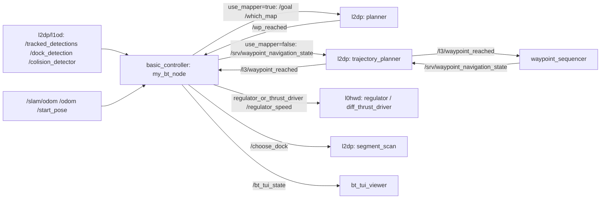

# l3nav

> [!skrot] W 30 sekund
> - **Co to:** warstwa L3 — decyzja i misje. Główny pakiet [[basic_controller]] to drzewa zachowań (BehaviorTree.CPP v4) dla zadań konkursowych (Monako 2026, Njord 2026, RoboBoat); prosty [[waypoint_sequencer]] wysyła listę punktów z YAML. Do tego `ros_guide` (mkdocs z wprowadzeniem do ROS 2) i `gitenv.sh` (alias formatowania).
> - **Wejście → wyjście:** `/tracked_detections`, `/dock_detection`, `/colision_detector`, `/slam/odom`, `/odom`, `/start_pose`, `detected_signals` → waypointy do L2 (`/goal` → [[planner]] albo serwis `/srv/waypoint_navigation_state` → [[trajectory_planner]]), wybór sterownika `regulator_or_thrust_driver` → [[l0hwd]], `/which_map`, `/regulator_speed`, `/robot/task`, `melody`, `/bt_tui_state`.
> - **Gdzie w łodzi:** na Jetsonie razem z L2 — **niepewne** (wniosek z charakteru niezacommitowanych zmian „z zawodów” odpowiadających commitowi `0d444ff` w [[l2dp]]; brak remote `jetson` w tej kopii).

Przepływ całości: [[Nawigacja i autonomia — przepływ]].

## Struktura katalogów
```
l3nav/
├── basic_controller/            pakiet BT (ament_cmake)
│   ├── src/ (57 plików + tui/)  węzły BT, my_bt_node.cpp, main.cpp, bt_registration.cpp
│   ├── include/ (+ tui/)        nagłówki węzłów, TUI (UiEventBus, NodeTuiLogger)
│   ├── config/                  drzewa XML ładowane automatycznie
│   │   ├── monaco_trees/        Monako 2026 (CelkaOsemka…, Sprint, Slalom, DockingMonaco, RegTest…)
│   │   ├── njord_trees/         Njord 2026 (CollisionNjord, ManNjord1/2, DockNjordNorm/Parl, Spisslonn…)
│   │   ├── rb_trees/            RoboBoat (entry/exit, docking, delivery, speed challenge, nav channel)
│   │   └── tests/               mocki JSON dla test_runner (pomijane przez my_bt_node)
│   ├── tests/test_runner.cpp    uruchamianie drzewa z mockami
│   └── plugin_description.xml   opis klas BT (częściowo nieaktualny — np. NavigateToGoal)
├── waypoint_sequencer/          sekwencer punktów z config/waypoints.yaml
├── ros_guide/                   mkdocs „Solar L3”: docs/guide.md (wprowadzenie do ROS 2), docs/l3docs.md (stary opis VesselHandler), jakodpalic.md
├── gitenv.sh                    alias l3_format (clang-format -style=file:.clang-format-l3)
├── .gitlab-ci.yml, .clang-format-l3, README.md
```

## Pakiety ROS
- [[basic_controller]] — drzewa zachowań, `my_bt_node`, TUI `bt_tui_viewer`, `test_runner`; zwrotnica `NextWaypoint` do L2.
- [[waypoint_sequencer]] — lista punktów z YAML do `trajectory_planner`, peryferia na punktach specjalnych.

## Jak to się łączy


## Budowanie i uruchamianie
- Zależności z README: `sudo apt install ros-humble-nav2-core ros-humble-behaviortree-cpp ros-humble-pcl-ros ccache lld`.
- `colcon build`; `ros2 run basic_controller basic_controller_exec` (domyślne drzewo `SimpleTree`) lub `--ros-args -p main_tree_name:=<ID>`; `ros2 run basic_controller bt_tui_viewer`; `ros2 run basic_controller test_runner <Tree> <mock.json>`.
- Dokumentacja: `cd ros_guide; python -m venv venv; source venv/bin/activate; pip install -r requirements.txt; mkdocs serve` (`ros_guide/jakodpalic.md`; `requirements.txt` jest pusty).
- CI (`.gitlab-ci.yml`): obraz `althack/ros2:humble-full`, apt: can-msgs, nmea-msgs, geographic-msgs, diagnostic-updater, robot-localization, pcl-ros, nav2-costmap-2d, nav2-core, behaviortree-cpp; klon [[ros-sbt-interfaces]] z tokenem CI (`‹ukryte›`); etapy `build` i `test` (`colcon test --return-code-on-test-failure`).

## Konfiguracja
- `basic_controller/config/**/*.xml` — drzewa (lista i opisy w [[basic_controller]]).
- `waypoint_sequencer/config/waypoints.yaml` — 10 punktów.
- Blackboard startowy: `speed_limit (2.5, 1.5)` (`bt_registration.cpp:316`).

## Branche
Stan remote = fetch z 2026-10-01 18:07 (`.git/FETCH_HEAD`). `origin/master` = `dd07b54` (2026-07-19, Martyna Czerniak, „merge monaco-cleanup and apply final fixes”). Gałęzi `monaco-cleanup` nie ma już jako ref — istnieje tylko w treści commita merge (`3ac9a7f` „cleanup after monaco” 2026-07-18, `b77dc59` „tree fix after cleanup”).

| Gałąź | Ostatni commit | za/przed master | Zmergowana | Status |
|---|---|---|---|---|
| `master` / `origin/master` | `dd07b54` 2026-07-19 Martyna Czerniak | 0/0 | — | stan po Monako 2026 |
| `waypoint_first` (lokalna, **HEAD**) | `e336cd3` 2026-08-12 juliadcz — piotrek rozjebal | 0/27 | nie | Njord; brak na remote; drzewo robocze z niezacommitowanym stanem zawodów |
| `melody` / `origin/melody` | `d6db1c1` 2026-08-12 juliadcz — otter na żyletki | 0/27 | nie | Njord, równoległa do `waypoint_first` (wspólna baza `95d3741`) |
| `njord_trees` / `origin/njord_trees` | `35b6cb4` 2026-07-31 juliadcz — rewrite cmake for a faster build | 0/8 | nie | wmergowana do `melody` |
| `origin/docking_njord` | `5a85118` 2026-07-25 juliadcz — good gnss for sim, tree works well | 0/13 | nie | wmergowana do `melody` (`4670078`) |
| `origin/maneuvering_njord26` | `9a86f89` 2026-06-14 juliadcz | 13/7 | nie | wczesne manewry Njord (przerywanie NextWaypoint), martwa |
| `origin/formating` | `24bbbed` 2026-05-27 janSochaOfficial | 30/8 | nie | formatowanie, `.h→.hpp`, githooks; martwa |
| `origin/entry_exit_after_rb` | `e94ca03` 2026-04-26 Piotr Kędziora | 29/14 | nie | entry/exit po RoboBoat; martwa |
| `origin/mock_testing` | `08ca407` 2026-04-21 Kacper Kustra | 30/1 | nie | drzewa stres-testów NextWaypoint; martwa |
| `origin/tui_drzewkowe` | `48178ac` 2026-04-28 Martyna Czerniak — readme for tui | 39/0 | **tak** | zmergowana |
| `origin/bt_visualization` | `7c56333` 2026-02-25 janSochaOfficial | 118/2 | nie | logowanie BT przez websocket; martwa |
| `origin/tests_tree` | `a3747ab` 2026-02-12 filnaw | 131/0 | **tak** | zmergowana |
| `origin/Docker_l3` | `db953e9` 2025-12-13 Martyna Czerniak — migration to btv4 fix | 143/7 | nie | Docker dla L3; martwa |
| `origin/foxglove_audio_output` | `dc657a3` 2025-12-13 Martyna Czerniak | 143/7 | nie | wyjście audio do Foxglove (+61 tys. linii danych audio); martwa |

Tagi: `archive/archived_main` (2025-10-13, „code for RB25”), `archive/bt-testing` (2025-06-22, „archived nav2 and slam approach”), `archive/monaco_2026` (`585949d`, 2026-07-17), `archive/monako_2025` (2025-10-23), `archive/obstacle_avoidance` (2025-02-14).

### Linia Njord
`995a830`/`9b429d6` (2026-07-20, collision tree, uniwersalny GNSS) → `njord_trees` (manewry, `DeleteWaypoints`, `detection_area`) → `67bb06e` „barka orchestry”, `605bf60` „chane to send first CanDriver” → merge `origin/docking_njord` (dokowanie z nowymi węzłami kontrolera, GNSS) → `fcd9b01` „adjusted docking and tree with only logs” → `6f77e41` „…nowa sekcja muzyki” → `2dda953` „przywroc” → `95d3741` „las sie pali” (2026-08-12) → rozgałęzienie: `melody` (`d6db1c1`: `collision_njord.xml`, `move_along_heading.cpp`) i `waypoint_first` (`e336cd3`: `detect_buoy.cpp`, `set_buoy_waypoints.cpp`). `git diff origin/master...waypoint_first`: 45 plików, +2403/−403 (drzewa `njord_trees/`, nagłówki i źródła węzłów).

**Stan z zawodów Njord** = `waypoint_first` + niezacommitowane drzewo robocze (patrz niżej) — nigdzie nie zacommitowane.

## Kopie lokalne
| Ścieżka | Wymeldowana gałąź | HEAD | Drzewo robocze | Fetch |
|---|---|---|---|---|
| `~/solar/l3nav` | `waypoint_first` | `e336cd3` 2026-08-12 | 21 zmodyfikowanych + 1 usunięty + 4 nieśledzone, wszystko w `basic_controller/` (`config/njord_trees`, `include`, `src`, `CMakeLists.txt`): nowe `select_dock.{h,cpp}`, `spisslonn.xml`, `maneuvering_surprise.xml`, usunięty `surprisetask.xml`; `NextWaypoint` z `/which_map` i `/regulator_speed` | FETCH_HEAD 2026-10-01 18:07 |
| `~/solar/bash_do_uruchomienia/l3nav` | `master` | `dd07b54` 2026-07-19 | czyste | brak FETCH_HEAD; `origin/njord_trees` widziany jako `dac887d` (starszy fetch), brak `melody` |

## Znane problemy / TODO
- `detected_signals`: `my_bt_node` subskrybuje `std_msgs/String` z QoS transient_local, a [[blast_detection]] publikuje `l2_interfaces/BlastDetection` — niezgodność typów.
- `NextWaypoint`: dwa różne sygnały końca (`/wp_reached` z planera vs `/l3/waypoint_reached` z trajectory_planner) zależnie od `use_mapper`; pomyłka = drzewo stoi.
- Przy `steering` domyślnym (`regulator`) i `use_mapper=false` regulator w [[l0hwd]] czeka na `/path_points`, których nikt nie publikuje (planer działa tylko na `/goal`), a `diff_thrust_driver` ma `use=false` — **niepewne**, czy drzewa z `use_mapper=false` ustawiały `steering="thrust_driver"` (w drzewach Njord port `steering` nie występuje w aktywnych `NextWaypoint`).
- Zależności `nav2_*` w `package.xml` bez użycia w kodzie; `plugin_description.xml` opisuje nieistniejące węzły (`NavigateToGoal`, `LookForGreen`…).
- `ros_guide/docs/l3docs.md` opisuje nieistniejący już `VesselHandler` (wszystko w komentarzu HTML).
- Nazwy melodii w `melody_to_tone` zawierają wulgarne/obraźliwe etykiety (bez znaczenia technicznego).

## Źródła
`basic_controller/src/my_bt_node.cpp`, `src/next_waypoint_node.cpp`, `src/bt_registration.cpp`, `src/steer_to_dock.cpp`, `src/select_dock.cpp`, `src/breaking.cpp`, `src/gnss_to_local.cpp`, `config/njord_trees/*.xml`, `CMakeLists.txt`, `package.xml`, `waypoint_sequencer/src/waypoint_sequencer.cpp`, `README.md`, `.gitlab-ci.yml`, `git log`/`git diff` gałęzi.

## Moje notatki
> [!ja] Tu piszesz ty — Albert tej sekcji nie rusza.
