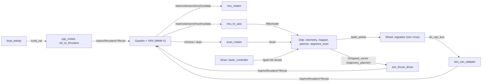

# l4sim

> [!skrot] W 30 sekund
> - **Co to:** symulacja łodzi w **Gazebo Garden + VRX** (Virtual RobotX, model WAM-V jako „barka”) w Dockerze, z CLI `solar3000`. Własne światy konkursowe (Monako 2026 „figure 8”, Njord docking/maneuvering/nav, RoboBoat 2024/2026) i węzły L4, które podmieniają sprzęt: IMU/LiDAR obrócone do konwencji łodzi, `/filter/euler` jak z Xsensa, a polecenia napędu (`/to_can_bus` albo `/l2/speed_vector`) zamieniane na ciągi pędników Gazebo.
> - **Wejście → wyjście:** z Gazebo: `/wamv/sensors/imu/imu/data`, `/wamv/sensors/gps/gps/fix`, chmura/skan; do Gazebo: `/wamv/thrusters/{left,right}/thrust`. Pomiędzy — prawdziwe L2/L3 z [[l2dp]] i [[l3nav]] uruchomione obok.
> - **Gdzie:** PC deweloperski (Docker, WSL2/Linux, opcjonalnie GPU NVIDIA).

Uwaga: w nazewnictwie warstw „L4” bywa też używane dla [[ros-sbt-interfaces]] (`l4_interfaces`); to repo to symulacja. Jedyna kopia: `~/solar/bash_do_uruchomienia/l4sim`.

## Struktura katalogów
```
l4sim/
├── src/
│   ├── vrx/                 VRX upstream + własne światy/modele: vrx_gz, vrx_ros, vrx_urdf/{wamv_description,wamv_gazebo,vrx_gazebo}
│   ├── sim_can_adapter/     /to_can_bus → pędniki (podmiana CAN)
│   ├── sim_thrust_driver/   /l2/speed_vector → pędniki (podmiana diff_thrust_driver)
│   ├── imu_rotator/         obrót IMU o −90° (yaw 0 = północ)
│   ├── imu_to_yaw/          IMU → /filter/euler (jak Xsens)
│   ├── scan_rotator/        obrót LaserScan o 90° (/scan_prerotated → /scan)
│   ├── course_imu/          IMU → /sim/imu/course, /sim/imu/velocity (stare)
│   ├── gps_to_course_converter/  GPS → /course/data_sim (stare)
│   ├── new_odometry/        pakiet cpp_nodes: /odom2 + vel_to_thrusters (/cmd_vel)
│   ├── odom_to_tf/          pakiet odom_to_tf_sim: TF odom → wamv/wamv/base_link
│   ├── testThrust/          pakiet test_thrust: sekwencja testowa pędników
│   ├── l4_teleop/src/boat_teleop/  WASD → /cmd_vel
│   ├── l4_launch/           launch/sim.yaml, config/bridge_config.yaml
│   ├── can_msgs/            kopia pakietu can_msgs
│   └── start-simulation-in-docker.sh, start-simulation-test.sh
├── bin/solar3000            CLI (v1.1.0)
├── scripts/, tools/         instalacja, WSL2, GPU, diagnostyka X11/Gazebo
├── docs/                    WORLDS.md, CHEATSHEET.md, WSL2_GUIDE.md, GPU_QUICK_FIX.md, …
├── legacy/                  stare setup.sh/start.sh
├── Dockerfile.sim, docker-compose*.yml, entrypoint.sh, install-*.sh, completions/
```

## Pakiety ROS
- Własne: [[sim_can_adapter]], [[sim_thrust_driver]], [[imu_rotator]], [[imu_to_yaw]], [[scan_rotator]], [[course_imu]], [[gps_to_course_converter]], [[cpp_nodes]] (katalog `new_odometry`), [[odom_to_tf_sim]] (katalog `odom_to_tf`), [[test_thrust]] (katalog `testThrust`), [[boat_teleop]], [[l4_launch]].
- VRX (upstream z lokalnymi światami/modelami): [[vrx_gz]], [[vrx_ros]], [[vrx_gazebo]], [[wamv_description]], [[wamv_gazebo]].
- [[can_msgs]] — kopia definicji ramki CAN (ta sama nazwa co w [[l0hwd]]).

## Jak to się łączy
Dwie ścieżki napędu z README (`README.md`, sekcja „Running the Simulation”):



Jak podmienia sprzęt: `sim_can_adapter` zastępuje magistralę CAN i sterowniki silników (`regulator` z [[l0hwd]] w trybie `sim:=true` czyta IMU z `/wamv/sensors/imu/imu/data` — `l0hwd/regulator/src/regulator.cpp`), `sim_thrust_driver` zastępuje `diff_thrust_driver`, `imu_to_yaw` udaje topik Xsensa `/filter/euler`, `imu_rotator`/`scan_rotator` korygują osie (README: „X – North, Y – East”).

## Budowanie i uruchamianie
**Docker / CLI** (README, część „Solar 3000”):
```
./tools/install-wizard.sh          # Docker, X11/WSL2, instalacja CLI, konfiguracja
solar3000 start                    # start symulacji (świat domyślny)
solar3000 worlds                   # lista światów
```
Komendy CLI (`bin/solar3000`): `start`, `setup|install`, `build`, `stop`, `clean`, `diagnose|check|doctor`, `gazebo-fix`, `worlds|list`, `logs`, `shell|bash|exec`, `status`, `config`, `version`. Konfiguracja użytkownika `~/.solar3000rc` (z `config/.solar3000rc.example`: `USE_GPU`, `DEFAULT_WORLD`, limity).
- `Dockerfile.sim`: `osrf/ros:humble-desktop` + `gz-garden`, `ros-humble-ros-gzgarden`, xacro, rviz2, `rmw_cyclonedds_cpp`; kopiuje do obrazu tylko `can_msgs`, `course_imu`, `gps_to_course_converter`, `l4_launch`, `sim_can_adapter`, `vrx` i buduje `colcon build --merge-install`; `ENV VRX_DEFAULT_WORLD=sydney_regatta`, `ROS_DOMAIN_ID=68`, `RMW_IMPLEMENTATION=rmw_cyclonedds_cpp`.
- `docker-compose.yml`: `ROS_DOMAIN_ID=42` (inne niż w Dockerfile), `network_mode: host`, `privileged`, X11 socket, komenda `/scripts/start-simulation-test.sh` → `ros2 launch vrx_gz competition.launch.py world:=$WORLD_NAME` (renderowanie programowe `LIBGL_ALWAYS_SOFTWARE=1`), po 10 s `ros2 launch l4_launch sim.yaml`.

**Ręcznie, cały stos** (README, „Launch WAM-V Simulation”; README wskazuje gałąź `l4_axes_rotated` — w repo istnieje `origin/axes_rotated`, już zmergowana):
```
ros2 launch vrx_gz competition.launch.py world:=RB_FOLLOW_THE_PATH
ros2 launch vrx_gazebo rviz.launch.py use_sim_time:=true
ros2 run imu_rotator ImuRotator
ros2 run odometry odo_cpp_node
ros2 launch pointcloud_to_laserscan sample_pointcloud_to_laserscan_launch.py
ros2 run scan_rotator ScanRotator
ros2 run mapper mapper
ros2 run planner planner
# z regulatorem:
ros2 run imu_to_yaw imu_to_yaw
ros2 run sim_can_adapter SimCanAdapter
ros2 run regulator Regulator --ros-args -p sim:=true
# albo z trajectory plannerem:
ros2 run TrajectoryPlanner TrajectoryPlannerNode
ros2 run sim_thrust_driver SimThrustDriver
# drzewo:
ros2 run basic_controller basic_controller_exec
# symulacja gwizdków:
ros2 topic pub /detected_signals std_msgs/msg/String "{data: 1}"
```
Uwagi: `ros2 run TrajectoryPlanner …` — pakiet nazywa się `trajectory_planner` ([[trajectory_planner]]). README opisuje zestaw z `mapper` i `/costmap` (sprzed SLAM) — dla stanu Njord planer czyta `/slam/global_costmap` z [[pose_graph]] (**niepewne**, czy SLAM był uruchamiany w symulacji).

## Konfiguracja
- `src/l4_launch/launch/sim.yaml` — `SimCanAdapter` + `CourseImu`.
- `src/l4_launch/config/bridge_config.yaml` — most kamery (obraz + chmura).
- Światy: `src/vrx/vrx_gz/worlds/*.sdf` (lista w [[vrx_gz]]); opis po polsku `docs/WORLDS.md` (NJORD_NAV domyślny).
- `MONACO26_FIGURE8.sdf` (`7a789a2`, juliadcz, 2026-05-25): dwie boje `NJORD_GREEN` do ósemki (zadanie Monako „celka ósemka” — drzewa `CelkaOsemka*` w [[basic_controller]]); URI modeli to ścieżki bezwzględne `/home/solar/l4sim/install/...`.

## Branche
Brak `.git/FETCH_HEAD` — data ostatniego fetch nieznana. `origin/main` = `7a789a2` (2026-05-25, juliadcz, „monaco figure 8”).

| Gałąź | Ostatni commit | za/przed main | Zmergowana | Co zmienia |
|---|---|---|---|---|
| `main` (HEAD) / `origin/main` | `7a789a2` 2026-05-25 juliadcz — monaco figure 8 | 0/0 | — | świat Monako |
| `origin/collision-world` | `d49626f` 2026-07-27 Martyna Czerniak — smaller moving boat model | 4/2 | nie | świat kolizji Njord + `NJORD_SMALL_MOVING_BOAT` (+705 linii); **najnowsza**, przygotowanie do Njord |
| `origin/depth-camera` | `dfc897c` 2026-03-10 Mateusz | 4/0 | **tak** | kamera głębi, świat RB26_LIGHT |
| `origin/axes_rotated` | `27a2a8e` 2026-02-18 filnaw — add follow the path | 6/0 | **tak** | węzły obracające osie, follow the path |
| `origin/dockerized_detections` | `02892b0` 2025-11-19 patryk_kozlowski — wybor swiata w solar3000 start-full | 14/11 | nie | automatyczne budowanie pakietów przy starcie, detekcje w Dockerze (54 pliki); martwa |
| `origin/small-sim` | `851370e` 2025-11-23 Kacper Kustra — make barka smaller | 13/1 | nie | zmniejszony WAM-V; martwa |

Tagi: `archive/bh-testing` (2025-06-20), `archive/controller_wrapper` (2025-08-05), `archive/slam-testing` (2025-06-09), `archive/smac-lattice-planner-test` (2025-05-07 — test planera Smac z Nav2, porzucony).

Historia `main` (wybór): `35d3cf2`/`526ab60` (2025-10/11, UmarlyPoeta: konfiguracja, akceleracja GPU), `0f941bb` (patryk_kozlowski: interaktywny config solar3000), `8f706d1` „Nodes rotating axes”, `79fbf14`/`b7e092c` docking world, `8df0c4d` „re scaled simulation”, `137feae` „correct center of gravity, controller handle and test scripts”, `27a2a8e` follow the path, `dfc897c` depth camera, `7a789a2` monaco figure 8.

## Kopie lokalne
| Ścieżka | Gałąź | HEAD | Drzewo robocze |
|---|---|---|---|
| `~/solar/bash_do_uruchomienia/l4sim` | `main` | `7a789a2` | czyste |

## Znane problemy / TODO
- `sim_can_adapter` nie filtruje ID ramek CAN.
- `ROS_DOMAIN_ID` 68 (Dockerfile) vs 42 (compose).
- `MONACO26_FIGURE8.sdf` z bezwzględnymi ścieżkami `/home/solar/l4sim/...`.
- `scan_rotator`: README mówi `/scan_rotated`, kod publikuje `/scan`.
- README odsyła do nieistniejącej gałęzi `l4_axes_rotated` i pakietu `TrajectoryPlanner`.
- Obraz Dockera nie zawiera `sim_thrust_driver`, `imu_rotator`, `imu_to_yaw`, `scan_rotator`, teleopu — trzeba je budować osobno.

## Źródła
`README.md`, `Dockerfile.sim`, `docker-compose.yml`, `src/start-simulation-test.sh`, `bin/solar3000`, `docs/WORLDS.md`, `src/*/src/*.cpp`, `src/l4_launch/*`, `src/vrx/vrx_gz/worlds/MONACO26_FIGURE8.sdf`, `git log`/`git diff` gałęzi.

## Moje notatki
> [!ja] Tu piszesz ty — Albert tej sekcji nie rusza.
