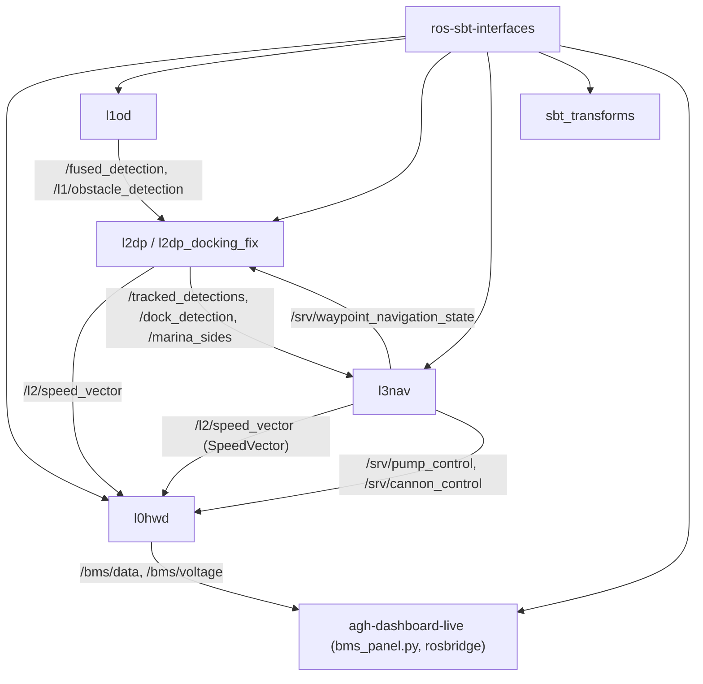

# ros-sbt-interfaces

> [!skrot] W 30 sekund
> - **Co to:** wspólne definicje wiadomości i serwisów ROS 2 dla wszystkich warstw stosu (L0–L4). README: „gathers ROS interfaces from all 3 layers … used as a submodule”. W `~/solar` repo jest jednak sklonowane osobno, nie jako submoduł.
> - **Wejście → wyjście:** pliki `.msg`/`.srv` → `rosidl_generate_interfaces` → typy C++/Python używane przez [[l0hwd]], `l1od`, `l2dp`, `l3nav`, [[Pakiety/sbt_transforms|sbt_transforms]] i dashboard.
> - **Gdzie w łodzi:** budowane w każdym workspace, na Jetsonie i na PC. Pełna tabela pól i użyć: [[Interfejsy (msg, srv, action)]].

## Struktura katalogów
```
ros-sbt-interfaces/
├── l0_interfaces/   12 msg + 2 srv: sterowanie napędem, BMS, peryferia (pompa, działko)
├── l1_interfaces/   7 msg + 5 srv: detekcje wizyjne, klastry lidaru, fuzja, serwisy zbierania zdjęć
├── l2_interfaces/   6 msg + 2 srv: śledzone detekcje, dok, pozycja metryczna, sygnały dźwiękowe, serwis waypointów
├── l3_interfaces/   10 msg + 4 srv: misje, marina, dok, raporty speed challenge, TUI drzewa zachowań
├── l4_interfaces/   1 msg: WorldObject (symulacja)
├── .gitlab-ci.yml   CI: klon l0hwd, $L3_REPO_NAME, l2dp + colcon build
└── README.md
```

## Pakiety ROS
- [[l0_interfaces]] — `SpeedVector`, `BmsData`/`BmsVoltages`, `PumpControl`/`CannonControl`, `MissionState` i stare wiadomości GUI.
- [[l1_interfaces]] — `Detection`, `FusedDetection`, `Cluster` (+ wektory), serwisy `images_collector`.
- [[l2_interfaces]] — `TrackedDetection(sVector)`, `Dock`, `MetricPosition`, `BlastDetection`, `SetHome`, `WaypointNavigationState`.
- [[l3_interfaces]] — `MarinaEntry/Sides`, `Dock`, `Delivery`, `SpeedReport`, `Tui*`, `MissionControl`, `LoadControl`…
- [[l4_interfaces]] — `WorldObject`.

## Jak to się łączy



## Budowanie i uruchamianie
- W workspace: `colcon build --packages-select l0_interfaces l1_interfaces l2_interfaces l3_interfaces l4_interfaces`. `l3_interfaces` zależy od `l2_interfaces`.
- CI (`.gitlab-ci.yml`): obraz `althack/ros2:humble-full`, apt `ros-humble-can-msgs … nav2-costmap-2d nav2-core behaviortree-cpp-v3`. Klonuje rekurencyjnie `l0hwd`, `$L3_REPO_NAME` i `l2dp` (z tokenem CI ‹ukryte›), potem `colcon build`. Reguły: gałąź `main` i merge requesty.

## Konfiguracja
Brak plików konfiguracyjnych. Zależności generatora:
- `l0`: `std_msgs`;
- `l1`, `l2`: `std_msgs std_srvs sensor_msgs geometry_msgs`;
- `l3`: `std_msgs std_srvs l2_interfaces` (+ `builtin_interfaces` w `package.xml`);
- `l4`: `std_msgs std_srvs`.

## Branche
Ostatni fetch: `.git/FETCH_HEAD` wskazuje `main` = `54b0f3d`, a `origin/main` = `f1de70b` (późniejszy merge, który zrobiła i wypchnęła juliadcz). Mtime pliku 2026-10-01 18:07 (prawdopodobnie czas kopiowania, **niepewne**). Wymeldowana: **`main` @ `f1de70b`**, drzewo robocze czyste.

| gałąź | ostatni commit | przed/za main | zmergowana | status |
|---|---|---|---|---|
| `main` | `f1de70b` 2026-08-10 juliadcz „Merge branch 'main' …” | 0/0 | — | **produkcyjna** (stan po Njord 2026: „docking njord”, „slam+fusion”) |
| `origin/jenkins` | `81e5c2c` 2026-05-31 juliadcz „jenkinsfile update” | +2/−5 | nie | aktywna/boczna |
| `origin/l3_tui_msgs` | `ea8f48e` 2026-04-28 Martyna Czerniak „tui progress msg update” | 0/−12 | **tak** (merge `44a31d3`) | martwa (zmergowana) |
| `origin/tracking_debug` | `bfe713f` 2025-03-07 szymon_nowak „detection types and classes update” | +2/−75 | nie | martwa |

### main — ostatnie zmiany
- `57c73d4` (2026-08-10) „docking njord”: dodaje `l2_interfaces/msg/Dock.msg`.
- `d9c4fa3` (2026-08-10, MKalandykM) „slam+fusion”: `TrackedDetection.spatial_points_size`.
- `c7322b5` (2026-07-21) „can changes”: `BmsData`, `BmsUnitData`, `BmsVoltages`, `CellVoltages`.
- `44a31d3` (2026-04-29): merge `l3_tui_msgs` (`TuiEvent/State/Transition`).
- `07b17e6` (2026-04-13): merge `merge_interfaces` + `communication_protobuf`.
- `01b72cd` (2025-10-15) „l1 to l0”: zmiana nazwy `l1_interfaces` (stare L1 hardware) na `l0_interfaces`.

### jenkins
Dodaje `Jenkinsfile` (110 linii): pipeline z `ROS_DISTRO=humble`, workspace `${WORKSPACE}/ros2_ws`, symlink repo do `src`, `rosdep install`, budowanie, timeout 2 h.

### tracking_debug
Starsze podejście do śledzenia: `l2_interfaces/msg/Detection.msg`, `TrackedDetection.msg`, `VectorOfTrackedDetections.msg`. Na `main` zastąpione przez `TrackedDetectionsVector`.

## Kopie lokalne
| ścieżka | gałąź | HEAD | zmiany | fetch |
|---|---|---|---|---|
| `~/solar/ros-sbt-interfaces` | `main` | `f1de70b` | 0 | FETCH_HEAD mtime 2026-10-01 |
| `~/solar/bash_do_uruchomienia/ros-sbt-interfaces` | `main` | `c7322b5` (2026-07-21 „can changes”), **4 za `origin/main`** | 0 | FETCH_HEAD mtime 2026-09-07 |

W kopii `bash_do_uruchomienia` brakuje względem `main` tylko: `l2_interfaces/msg/Dock.msg` (+ wpis w CMake) i pola `TrackedDetection.spatial_points_size` (`git diff c7322b5 f1de70b`). Kod `l2dp`/`l3nav` z gałęzi z dokowaniem nie zbuduje się na tej kopii.

## Znane problemy / TODO
- README: „TODO: automatic main branch fetch from source repositories.”
- `l0_interfaces/srv/CannonControl.srv`: komentarze „# IDK ask Damian” przy obu polach żądania. [[peripherals_handler]] ich nie czyta.
- `PumpControl.srv`: „timeout in seconds”, a ramka CAN ma `ms` (patrz [[peripherals_handler]]). Nazwy pól z literówką `pomp_*`.
- Stałe detekcji powielone w trzech plikach (patrz [[Interfejsy (msg, srv, action)#Obserwacje]]).
- `l3_interfaces` używa `geometry_msgs` bez deklaracji zależności.

## Źródła
`README.md`, `.gitlab-ci.yml`, `*/package.xml`, `*/CMakeLists.txt`, wszystkie `*/msg/*.msg`, `*/srv/*.srv`, `git log`/`git diff` gałęzi.

## Moje notatki
> [!ja] Tu piszesz ty — Albert tej sekcji nie rusza.
