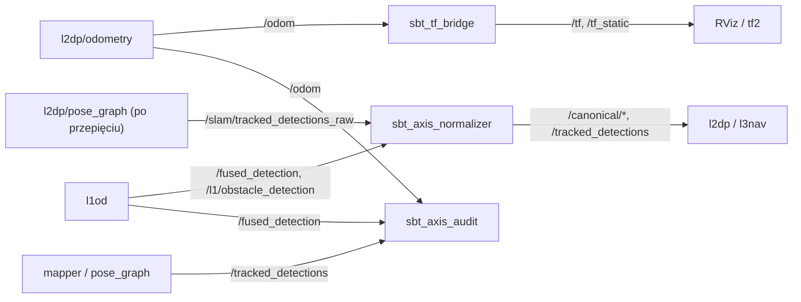

# sbt_transforms

> [!skrot] W 30 sekund
> - **Co to:** pakiet ROS 2 (`ament_cmake` + Python), który ma porządkować konwencje osi i ramek w całym stosie L0–L4. Zawiera bibliotekę konwersji (C++ header-only z portem w Pythonie), most TF (`sbt_tf_bridge`), republisher normalizujący topiki (`sbt_axis_normalizer`) i audyt w czasie działania (`sbt_axis_audit`). Do tego audyt `REVIEW.md` i kurs `KURS_OSI_I_MIGRACJA.md`.
> - **Wejście → wyjście:** `/odom` (pozycja NEU, orientacja NWU) → drzewo TF `map → odom → base_link → sensory` w ENU. Topiki detekcji → `/canonical/*` w REP-103.
> - **Gdzie w łodzi:** **katalog nie jest repozytorium git** (brak `.git`). Maintainer w `package.xml`: `patryk.kozlowski1104@gmail.com`. W kodzie łodzi nikt go jeszcze nie uruchamia ani nie linkuje. Pliki `__pycache__/*.cpython-313.pyc` wskazują, że testy Pythona puszczano na Pythonie 3.13, czyli nie na Humble/Ubuntu 22.04 (3.10).

## Struktura katalogów
```
sbt_transforms/
├── include/sbt_transforms/conventions.hpp    9 konwencji osi jako permutacje ze znakiem; static_assert skrętności
├── include/sbt_transforms/axis_transform.hpp yawFromQuaternion, bodyToWorld, convert, geodeticToLocal…
├── sbt_transforms/ (Python)                  conventions.py, axis_transform.py — port 1:1
├── src/tf_bridge_node.cpp                    sbt_tf_bridge
├── src/axis_normalizer_node.cpp              sbt_axis_normalizer
├── src/axis_audit_node.cpp                   sbt_axis_audit
├── config/sbt_transforms.yaml                parametry 3 węzłów
├── config/frames.yaml                        „księga”: jaka konwencja jest faktycznie na każdym topiku
├── launch/sbt_transforms.launch.py
├── test/test_axis_transform.{cpp,py}         23 testy C++, 24 Python (wg README)
├── README.md, REVIEW.md (audyt osi, PL), KURS_OSI_I_MIGRACJA.md (kurs + plan refaktoru, 1099 linii)
└── .pytest_cache/, __pycache__/              artefakty
```

## Pakiety ROS
- [[Pakiety/sbt_transforms|sbt_transforms]] — jedyny pakiet (wersja `1.0.0`).

## Jak to się łączy



Kontekst i drzewo ramek: [[Drzewo TF i układy współrzędnych]].

## Budowanie i uruchamianie
Z `README.md`:
```bash
colcon build --packages-select sbt_transforms
ros2 launch sbt_transforms sbt_transforms.launch.py   # args: params_file, enable_audit, enable_normalizer
colcon test --packages-select sbt_transforms && colcon test-result --all
```
Użycie biblioteki w innym pakiecie: `find_package(sbt_transforms REQUIRED)` + `target_link_libraries(my_node sbt_transforms)`. W Pythonie: `from sbt_transforms import NEU, FRU, YAW_COMPASS, BoatPose, body_to_world`.

## Konfiguracja
`config/sbt_transforms.yaml`:
- `sbt_tf_bridge`:
  - `odom.topic=/odom`, `position_convention=NEU`, `orientation_convention=NWU`;
  - ramki `map`, `odom`, `base_link`, `hesai_lidar`, `zed_left_camera_frame`, `zed_left_camera_optical_frame`;
  - `extrinsics.lidar_xyz=[0,0,0.78]`, `camera_xyz=[0,0,0.65]`, `lidar_convention=RFU`, `camera_convention=FLU`;
  - `publish_map_to_odom=true`.
- `sbt_axis_normalizer`: strumienie `fused_to_rep103`, `fused_to_world`, `clusters_to_rep103`, `tracked_from_slam`, `odom_to_rep103` (szczegóły w [[Pakiety/sbt_transforms|sbt_transforms]]).
- `sbt_axis_audit`: `course.topic=/true_heading/data`, `tracked.topic=/tracked_detections`, `fused.topic=/fused_detection`, `heading_tolerance_deg=15`, `min_speed_for_course_check=0.8`, `report_period_s=10`.

> [!wazne] Ekstrynsyki z symulacji
> README: „Measure `extrinsics.lidar_xyz` and `camera_xyz` on the hull before trusting the TF tree. The shipped values are the WAM-V simulation numbers found in `detection_pointcloud_fusion.cpp`, not the real boat.”

## Branche
Brak — katalog `~/solar/sbt_transforms` nie ma `.git`, więc nie ma historii, gałęzi ani remote. Data w `REVIEW.md`: „sprawdzone w kodzie na dzień 2026-08-09”.

## Kopie lokalne
- `~/solar/sbt_transforms`: jedyna kopia, bez kontroli wersji.

## Znane problemy / TODO
- `sbt_axis_audit` subskrybuje `/true_heading/data` (`l0_interfaces/msg/Course`). Na `l0hwd/master` ten publisher jest zakomentowany w [[can_driver]], więc kontrola kursu względem COG nie ma dziś danych. `frames.yaml` twierdzi, że producentem jest `l0hwd/can_driver`.
- Nagłówek `axis_audit_node.cpp:15` obiecuje wykrywanie „frame_id has no TF path”, a kod (`:219-223`) tylko loguje przypomnienie. Nie ma `tf2_ros::Buffer`/`TransformListener`.
- Nazwa ramki optycznej `zed_left_camera_optical_frame` różni się od nazwy z URDF ZED (`zed_left_camera_frame_optical`). Do tego `sbt_tf_bridge` i `zed_wrapper` publikowałyby rodzica `zed_left_camera_frame` z dwóch źródeł, a ZED dodatkowo `map → odom` (patrz [[Drzewo TF i układy współrzędnych]]).
- `KURS_OSI_I_MIGRACJA.md` §18 rysuje też `base_link → gnss_antenna`, którego `sbt_tf_bridge` nie publikuje.

## Źródła
`README.md`, `REVIEW.md`, `KURS_OSI_I_MIGRACJA.md` (spis rozdziałów, §18), `package.xml`, `CMakeLists.txt`, `launch/sbt_transforms.launch.py`, `config/*.yaml`, `src/*.cpp`.

## Moje notatki
> [!ja] Tu piszesz ty — Albert tej sekcji nie rusza.
