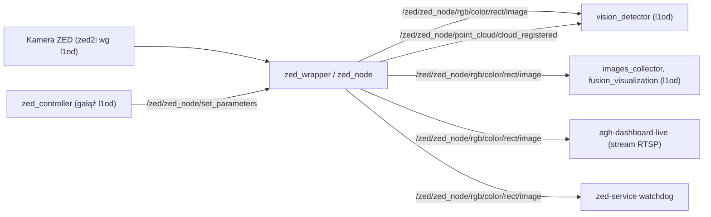

# zed-ros2-wrapper-humble-v5.1.0

> [!skrot] W 30 sekund
> - **Co to:** zewnętrzny wrapper ROS 2 Stereolabs dla kamer ZED, wersja **5.1.0** (`zed_wrapper/package.xml`, `CHANGELOG.rst`), wymaga ZED SDK v5.1 (`README.md:33`). Rozpakowany z `~/solar/zed-ros2-wrapper-humble-v5.1.0.zip` (komentarz archiwum: `458c72514c08856b2e911c011283eda2dae3b915`, pliki datowane 2025-12-04).
> - **Wejście → wyjście:** kamera ZED (USB/GMSL) → `/zed/zed_node/...` (obraz, chmura punktów, IMU, odometria, TF). Reszta systemu używa głównie `/zed/zed_node/rgb/color/rect/image` i `/zed/zed_node/point_cloud/cloud_registered`.
> - **Gdzie w łodzi:** Jetson (uruchamiany przez watchdog [[zed-service]]) — **niepewne**, czy z tej kopii.

## Struktura katalogów
```
zed-ros2-wrapper-humble-v5.1.0/
├── zed_wrapper/          pakiet z launch (zed_camera.launch.py), config/*.yaml, urdf/
├── zed_components/       komponenty C++ (zed_camera, zed_camera_one, tools)
├── zed_ros2/             metapakiet
├── docker/, .ci/, .github/, images/   upstream: Docker, CI, obrazki
├── COLCON_IGNORE         ← DODANY lokalnie (pusty plik); nie ma go w archiwum zip
└── CHANGELOG.rst, README.md, LICENSE
```

## Pakiety ROS
`zed_wrapper`, `zed_components`, `zed_ros2` (wszystkie 5.1.0) — kod Stereolabs, bez osobnych notatek.

## Jak to się łączy


## Budowanie i uruchamianie
Upstream: `ros2 launch zed_wrapper zed_camera.launch.py camera_model:=<model>`; nazwy topików `/<camera_name>/<node_name>/...`, domyślnie `camera_name=zed`, `node_name=zed_node` (`launch/zed_camera.launch.py:355-373`) → prefiks `/zed/zed_node/`. Watchdog [[zed-service]] uruchamia dokładnie ten launch z `LAUNCH_ARGS` (domyślnie `camera_model:=zedx`). Przez `COLCON_IGNORE` `colcon build` uruchomiony w `~/solar` pominie ten katalog.

## Konfiguracja
- **Zmiany względem oryginału:** porównanie katalogu z archiwum `zed-ros2-wrapper-humble-v5.1.0.zip` (`diff -rq`) — jedyna różnica to dodany pusty `COLCON_IGNORE`. Żaden plik konfiguracyjny nie jest zmieniony względem archiwum. **Niepewne:** czy samo archiwum = czysty upstream tagu v5.1.0 (nie porównywano z GitHubem — zakaz pobierania).
- `zed_wrapper/config/zed2i.yaml`: `camera_model: 'zed2i'`, `grab_resolution: 'HD1080'`, `grab_frame_rate: 15`, `depth.min_depth 0.01`, `max_depth 15.0`.
- `zed_wrapper/config/common_stereo.yaml` (kluczowe): `pub_resolution: 'CUSTOM'`, `pub_downscale_factor: 2.0` (HD1080 → 960×540 — zgodne z domyślnymi `camera_width 960`/`camera_height 540` w [[detection_pointcloud_fusion]]), `pub_frame_rate 15.0`, `depth_mode 'NEURAL_LIGHT'`, `point_cloud_freq 10.0`, `point_cloud_res 'COMPACT'`, `auto_exposure_gain true`, `exposure 80`, `publish_rgb true`, `publish_left_right false`, `pos_tracking_enabled true`, `publish_tf true`, `publish_map_tf true`, `publish_imu true`.
- **Model kamery:** pliki wrappera go nie przesądzają (są configi dla wszystkich modeli). [[l1od]] mówi o „zed2i” (`README.md`: „Processes data from zed2i camera”; `env_setup.sh`: „101 degrees, new zed2i”; `detection_fusion.hpp:28`), a [[zed-service]] domyślnie startuje z `camera_model:=zedx` — **niepewne**, który model jest faktycznie na łodzi.

### Topiki ZED używane w `~/solar`
| Topik | Kto | Plik |
|---|---|---|
| `/zed/zed_node/rgb/color/rect/image` | `vision_detector`, `images_collector`, `fusion_visualization`, `pub_test_imgs`, `zed_controller`, `zed-pls-dont-die.sh`, `agh-dashboard-live` | `l1od/vision_detector/vision_detector/detector.py:86` itd. |
| `/zed/zed_node/point_cloud/cloud_registered` | `vision_detector` | `detector.py:87` |
| `/zed/zed_node/rgb/color/rect/camera_info` | `detection_fusion` (gałąź `auto_fov_camera`) | `detection_fusion.hpp` na tej gałęzi |
| `/zed/zed_node/set_parameters` (serwis) | `zed_controller` (gałąź `zed_exposure_controller`) | `zed_controller.cpp:267` |
| `/zed/zed_node/left/image_rect_color` (stara nazwa sprzed v5.1) | [[fusion_camera_lidar]] | `lidar_camera_projection.py:117` |

`CHANGELOG.rst` v5.1.0: „BREAKING CHANGE” — `~/rgb/image_rect_color` → `~/rgb/color/rect/image`, `~/left/image_rect_color` → `~/left/color/rect/image` itd.; commit `440a352` w l1od (2025-12-07) „zed topic updated” dostosował L1 do nowych nazw.

## Branche
Nie dotyczy — katalog nie jest repozytorium git.

## Kopie lokalne
| Ścieżka | Uwagi |
|---|---|
| `~/solar/zed-ros2-wrapper-humble-v5.1.0/` | 84 pliki, + `COLCON_IGNORE` |
| `~/solar/zed-ros2-wrapper-humble-v5.1.0.zip` | 1 849 319 B, 108 wpisów |
| `~/solar/zed-ws/zed-ros2-wrapper` | pusty submoduł (inny commit upstreamu, `0722405`) — zob. [[zed-ws]] |

## Znane problemy / TODO
- Sprzeczność modelu kamery (zed2i w kodzie L1 vs `zedx` w watchdogu).
- Narzędzia z [[fusion_camera_lidar]] używają nazw topików sprzed v5.1.

## Źródła
`zed_wrapper/package.xml`, `CHANGELOG.rst`, `README.md`, `zed_wrapper/config/zed2i.yaml`, `zed_wrapper/config/common_stereo.yaml`, `zed_wrapper/launch/zed_camera.launch.py`, `diff -rq` z archiwum zip.

## Moje notatki
> [!ja] Tu piszesz ty — Albert tej sekcji nie rusza.
