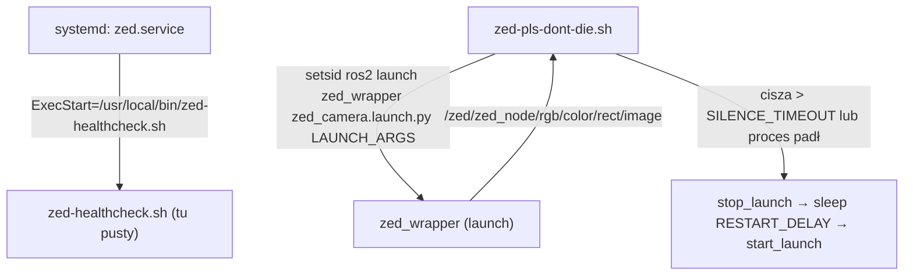

# zed-service

> [!skrot] W 30 sekund
> - **Co to:** watchdog kamery ZED: skrypt bash `zed-pls-dont-die.sh` uruchamia `ros2 launch zed_wrapper zed_camera.launch.py` i restartuje go, gdy proces padnie albo topik obrazu ucichnie; plus unit systemd `zed.service`.
> - **Wejście → wyjście:** obserwuje `/zed/zed_node/rgb/color/rect/image` (`ros2 topic echo --once`) → steruje procesem launcha (SIGINT/SIGKILL grupy procesów).
> - **Gdzie w łodzi:** **niepewne** — ścieżki (`/usr/local/bin/`, `/etc/default/zed`, `~/zed_ws`) wskazują na Jetsona, ale nie ma tu instalatora.

## Struktura katalogów
```
zed-service/
├── zed-pls-dont-die.sh   watchdog (3378 B) — cała logika
├── zed.service           unit systemd (1374 B)
├── zed-healthcheck.sh    PUSTY (0 B)
└── zed-run.sh            PUSTY (0 B)
```

## Pakiety ROS
Brak.

## Jak to się łączy


## Budowanie i uruchamianie
Ręcznie: `./zed-pls-dont-die.sh` jako zwykły użytkownik (NIE przez sudo). Zmienne do nadpisania w środowisku: `ROS_DOMAIN_ID`, `RMW_IMPLEMENTATION`, `ROS_SETUP`, `WS_SETUP`, `LAUNCH_PKG`, `LAUNCH_FILE`, `LAUNCH_ARGS`, `TOPIC`, `SILENCE_TIMEOUT`, `RESTART_DELAY`, `WARMUP`.

### Logika `zed-pls-dont-die.sh` krok po kroku
1. `set -o pipefail`; `SCRIPT_DIR` = katalog skryptu (`:3-5`).
2. **Blokada sudo** (`:7-11`): jeśli EUID=0 i ustawione `SUDO_USER` → komunikat (HOME staje się `/root`, znika `ROS_DOMAIN_ID`) i `exit 1`.
3. `ROS_DOMAIN_ID` domyślnie **69** (`:13`).
4. **Walidacja `RMW_IMPLEMENTATION`** (`:17-22`): jeśli ustawiona i nie pasuje do `^[A-Za-z0-9_]+$` → błąd „USZKODZONE RMW_IMPLEMENTATION” (chroni przed literówką `$VAR:-x}` w `.bashrc`, przez którą rcl wywala każdy węzeł i watchdog kręciłby się w kółko), `exit 1`.
5. **Pliki setup** (`:24-37`): `ROS_SETUP` = `/opt/ros/humble/setup.bash`; `WS_SETUP` = `$SCRIPT_DIR/install/setup.bash`, a jeśli go nie ma — `$HOME/zed_ws/install/setup.bash`. Brak któregoś → „BRAK PLIKU”, `exit 1`.
6. Domyślne: `LAUNCH_PKG=zed_wrapper`, `LAUNCH_FILE=zed_camera.launch.py`, `LAUNCH_ARGS=camera_model:=zedx`, `TOPIC=/zed/zed_node/rgb/color/rect/image`, `SILENCE_TIMEOUT=5` s, `RESTART_DELAY=10` s, `WARMUP=15` s (`:39-46`).
7. `source` obu setupów, potem `set -u` (`:49-51`).
8. `start_launch` (`:61-67`): `setsid ros2 launch … &` — nowa sesja/grupa procesów; zapamiętuje `LAUNCH_PID` i `LAUNCH_PGID` (`ps -o pgid=`).
9. `stop_launch` (`:69-88`): bez PGID → SIGINT do PID, 5 s, SIGKILL. Z PGID → SIGINT do całej grupy, czeka do 20 s (sprawdza `kill -0` co 1 s), potem SIGKILL grupy; `wait`.
10. `topic_alive` (`:90-92`): `timeout $SILENCE_TIMEOUT ros2 topic echo --once $TOPIC` — prawda, jeśli w ciągu 5 s przyjdzie choć jedna wiadomość.
11. `trap INT TERM` → „zyje, sprzątam”, `stop_launch`, `exit 0`.
12. **Pętla główna** (`:99-114`): `start_launch` → rozgrzewka do `WARMUP` s (jeśli proces padnie w trakcie: log „to nie kamera, sprawdz LAUNCH_ARGS/env” i wyjście z rozgrzewki) → `while proces żyje && topic_alive; do :; done` (ciągłe sprawdzanie; każda iteracja to nowe `ros2 topic echo --once`) → log „zabił się albo cisza na $TOPIC — restart” → `stop_launch` → `sleep RESTART_DELAY` → od nowa.

### `zed.service`
- `[Unit]`: `Description=ZED camera (zed_wrapper)`, `After=docker.service network-online.service`, `Requires=docker.service`, `StartLimitIntervalSec=300`, `StartLimitBurst=10` (max 10 startów na 5 min).
- `[Service]`: `Type=simple`, `EnvironmentFile=/etc/default/zed`, `ExecStart=/usr/local/bin/zed-healthcheck.sh`, `Restart=always`, `RestartSec=15`.
- `[Install]`: `WantedBy=multi-user.target`.
- Na końcu pliku luźna linia `BindsTo=zed.service — zatrzymanie kamery zatrzymuje watchdoga automatycznie.` — wygląda na notatkę o planowanym drugim unicie (watchdoga), nie jest poprawną dyrektywą w sekcji `[Install]`.

## Konfiguracja
`/etc/default/zed` (EnvironmentFile) — nie ma go w repo; **niepewne**, jakie zmienne zawiera (np. `LAUNCH_ARGS`).

## Branche
Nie dotyczy — brak `.git`.

## Kopie lokalne
Tylko `~/solar/zed-service`.

## Znane problemy / TODO
- `zed.service` wywołuje `zed-healthcheck.sh`, który tu jest pusty (0 B), a `zed-run.sh` też jest pusty — właściwa logika jest tylko w `zed-pls-dont-die.sh`. **Niepewne:** co faktycznie leży w `/usr/local/bin/zed-healthcheck.sh` na Jetsonie.
- `After=network-online.service` — w systemd standardem jest `network-online.target`.
- `Requires=docker.service`, choć skrypt nie używa Dockera.
- Domyślne `camera_model:=zedx` vs „zed2i” w [[l1od]] — sprzeczność do wyjaśnienia (może nadpisywane w `/etc/default/zed`).
- Pętla `while … topic_alive; do :; done` uruchamia proces `ros2` (CLI) w kółko bez przerwy — obciąża CPU przy działającej kamerze (wniosek z kodu).

## Źródła
`zed-pls-dont-die.sh`, `zed.service`.

## Moje notatki
> [!ja] Tu piszesz ty — Albert tej sekcji nie rusza.
