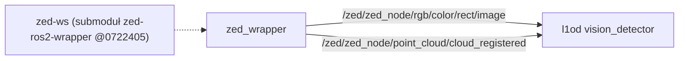

# zed-ws

> [!skrot] W 30 sekund
> - **Co to:** „L1 - ZED Workspace” (`README.md`) — pusty szkielet workspace z submodułem `zed-ros2-wrapper` (`https://github.com/stereolabs/zed-ros2-wrapper`, commit `0722405`). Brak własnego kodu.
> - **Wejście → wyjście:** —; wrapper ZED publikuje topiki `/zed/zed_node/...` (zob. [[zed-ros2-wrapper-humble-v5.1.0]]).
> - **Gdzie w łodzi:** **niepewne** — nie wiadomo, czy ten workspace jest używany na Jetsonie; skrypt [[zed-service]] szuka `install/setup.bash` w swoim katalogu albo w `~/zed_ws/install/setup.bash`.

## Struktura katalogów
```
zed-ws/
├── .gitmodules         submodule zed-ros2-wrapper → github.com/stereolabs/zed-ros2-wrapper
├── .gitignore          .vscode/, .idea/
├── README.md           „L1 - ZED Workspace / ZED Camera workspace.”
└── zed-ros2-wrapper/   gitlink 072240581f4f… — lokalnie PUSTY katalog (submoduł niezainicjalizowany)
```

## Pakiety ROS
Brak własnych; po inicjalizacji submodułu: pakiety wrappera Stereolabs (`zed_wrapper`, `zed_components`, `zed_ros2`) — opis w [[zed-ros2-wrapper-humble-v5.1.0]].

## Jak to się łączy


## Budowanie i uruchamianie
README nie zawiera instrukcji. **Niepewne:** wersja wrappera pod commitem `0722405` (nie można sprawdzić bez pobrania submodułu).

## Konfiguracja
Brak.

## Branche
Tylko `main` = `origin/main`, `d72d973` 2024-11-27 przemekdomagala „readme”. 5 commitów, wszystkie 2024-11-27 (Przemysław Domagała): initial commit, cleaning, wrapper, readme.

## Kopie lokalne
| Ścieżka | Gałąź | HEAD | Niezacommitowane | Ostatni fetch |
|---|---|---|---|---|
| `~/solar/zed-ws` | `main` | `d72d973` | brak; `zed-ros2-wrapper/` pusty | `.git/FETCH_HEAD` 2026-10-01 18:07 |
| `~/solar/bash_do_uruchomienia/zed-ws` | `main` | `d72d973` | brak; `zed-ros2-wrapper/` pusty | brak `FETCH_HEAD` |

## Znane problemy / TODO
- Repo martwe od 2024-11-27; w `~/solar` leży osobno nowszy wrapper [[zed-ros2-wrapper-humble-v5.1.0]] (archiwum z 2025-12-04), którego konwencja topików (`rgb/color/rect/image`) odpowiada temu, czego używa [[l1od]].

## Źródła
`README.md`, `.gitmodules`, `git ls-tree HEAD`, `git log`.

## Moje notatki
> [!ja] Tu piszesz ty — Albert tej sekcji nie rusza.
