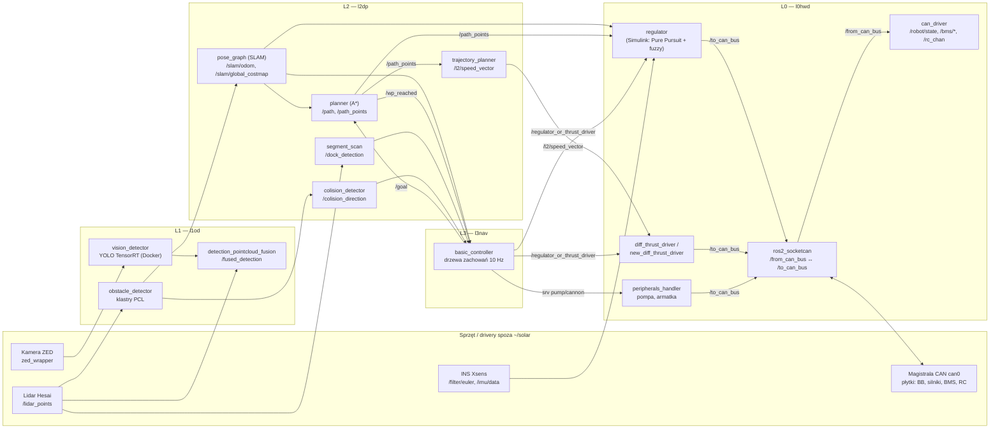

# Solar — barka autonomiczna (AGH Solar Boat): bunkier wiedzy

> [!skrot] W 30 sekund
> - **Co to:** pełny opis stosu łodzi autonomicznej z `~/solar`: 13 repozytoriów (17 kopii lokalnych), 82 notatki repo i pakietów, wszystkie gałęzie. Spisane z kodu 2026-10-04, ze ścieżkami do plików. Stan = kopie z Jetsona po zawodach (Njord), bez `git fetch`.
> - **Architektura warstwowa ROS 2 Humble:** L0 sprzęt i CAN → L1 percepcja → L2 lokalizacja i planowanie (własny stos, **nie Nav2**) → L3 misja (drzewa zachowań) → z powrotem do L0 przez ramki CAN. L4 to symulacja Gazebo + VRX.
> - **Zanim zaczniesz:** [[Znane problemy i ryzyka]] (m.in. kod z zawodów istniejący tylko lokalnie) i [[Branche — przegląd]].

## Jak to się łączy (najważniejszy przepływ)

Pełna lista połączeń (158 topików, 11 serwisów, z automatycznie wykrytymi niezgodnościami): [[Mapa topików i serwisów]].

## Warstwy i repozytoria

| Warstwa | Repo | Co robi | Główne pakiety |
|---|---|---|---|
| L0 sprzęt | [[l0hwd]] | Most ROS↔CAN, dekodowanie ramek, sterowanie silnikami (regulator, napęd różnicowy), peryferia, sonar | [[can_driver]], [[regulator]], [[diff_thrust_driver]], [[new_diff_thrust_driver]], [[peripherals_handler]], [[can_sequence]], [[swim_sequence]], [[sonar]], [[l0_launch]], [[ros2_socketcan]] |
| L0 definicje CAN | [[can-msgs]] | `barka.dbc`, ramki łodzi (submoduł l0hwd, gałąź `njord_2025`) | [[can_msgs]] |
| Interfejsy | [[ros-sbt-interfaces]] | 36 msg, 13 srv dla L0–L4 | [[l0_interfaces]], [[l1_interfaces]], [[l2_interfaces]], [[l3_interfaces]], [[l4_interfaces]] |
| L1 percepcja | [[l1od]] | Detekcja YOLO (boje), klastry przeszkód z lidaru, fuzja kamera–lidar, tracking | [[vision_detector]], [[obstacle_detector]], [[detection_pointcloud_fusion]], [[detection_fusion]], [[detection_fusion_projection]], [[tracking_detection]], [[fusion_visualization]], [[images_collector]], [[l1_launch]], [[zed_controller]] |
| L1 (stare) | [[fusion_camera_lidar]] | Wcześniejsza fuzja kamera–lidar | [[ros2_camera_lidar_fusion]] |
| L1 kamera | [[zed-ws]], [[zed-ros2-wrapper-humble-v5.1.0]], [[zed-service]] | Wrapper ZED 5.1.0, watchdog i usługa systemd | — |
| L2 planowanie | [[l2dp]] | SLAM (pose graph, costmapy), A*, regulator kursu, dokowanie, unikanie kolizji, raport protobuf | [[pose_graph]], [[planner]], [[trajectory_planner]], [[segment_scan]], [[colision_detector]], [[obstacle_avoidance]], [[odometry]], [[mapper]], [[fast_scan]], [[pointcloud_to_laserscan]], [[gps_calculator]], [[blast_detection]], [[signals_detector]], [[message_protobuf]], [[viz_correction]], [[ascii_map_viz2]] |
| L3 misja | [[l3nav]] | Drzewa zachowań: waypointy, dokowanie, kolizje, peryferia | [[basic_controller]], [[waypoint_sequencer]] |
| L4 symulacja | [[l4sim]] | Gazebo Garden + VRX (WAM-V), świat Monako, adaptery zamiast CAN | [[l4_launch]], [[sim_can_adapter]], [[sim_thrust_driver]], [[imu_to_yaw]] i inne |
| TF | [[Repozytoria/sbt_transforms]] | Most TF, konwencje osi (katalog bez gita) | [[Pakiety/sbt_transforms\|sbt_transforms]] |
| Łączność | [[dongle-service]] | Modem 5G Quectel, watchdog łącza, statystyki do ROS | [[dongle_statistic]] |
| Brzeg | [[agh-dashboard-live]] | Dashboard na żywo (rosbridge :9090, obraz, BMS) | — |
| Inna łódź | [[embedded-system]] | Firmware hydroskrzydłowca Delta/Celka (STM32F446, Zephyr), **nie barki** | — |

## Notatki zbiorcze
- [[Nawigacja i autonomia — przepływ]]: od waypointu do ramki CAN, tryby, dokowanie, kolizje.
- [[Regulator — hierarchia i działanie]] i [[Regulator — TODO, błędy i oscylacje]]: model Simulink od środka, przyczyny oscylacji, jak uprościć ścieżkę.
- [[Regulator od zera — 1. Co to jest i Simulink]]: ta sama wiedza od podstaw, z wykresami (seria 4 notatek).
- [[Magistrala CAN]]: ramki, ID, nadawcy, mapowanie CAN ↔ ROS.
- [[Interfejsy (msg, srv, action)]]: wszystkie typy wiadomości z polami i użyciem.
- [[Drzewo TF i układy współrzędnych]]: ramki, konwencje osi, kto co nadaje.
- [[Sensory i sprzęt]]: ZED, Hesai, Xsens, echosonda, Jetson (JetPack 6).
- [[Uruchamianie i launch]]: skrypty, 21 plików launch, „pełny start łodzi”, systemd, DDS i domeny.
- [[Środowisko developerskie (Docker ROS2)]]: `~/ros2-humble-gpu`, budowanie repo koła na PC.
- [[Rosbagi]]: nagrania i ich topiki.
- [[Dokumenty i raporty]]: `architektura.html` (pomocniczy, z listą błędów względem kodu), analiza dokowania.
- [[Git — praca z repozytoriami koła]]: GitLab `agh-solar-boat`, kopie, tożsamość, synchronizacja.
- [[Branche — przegląd]]: wszystkie gałęzie wszystkich repo.
- [[Znane problemy i ryzyka]]

## Stan „produkcyjny” (po zawodach Njord, sierpień 2026)
- **l2dp:** `feat/dock_costmap_fix@0d444ff` (kopia `l2dp_docking_fix`), a ta sama treść jest niezacommitowana w `~/solar/l2dp` na `spirala_zjebania`. Linia Monako 2026: `origin/celka_odo`. `master` jest starszy.
- **l3nav:** `waypoint_first@e336cd3` (tylko lokalnie) plus niezacommitowane zmiany. Monako: `master@dd07b54`.
- **l1od:** `refined-fusion@52dabf2`.
- **l0hwd:** `master@fd33338` („jetson changes”) plus niezacommitowane zmiany, w tym `regulator.cpp`.
- **l4sim:** `main@7a789a2` (Monako). Najnowsza jest `origin/collision-world`.

## Jak szukać
- **Gdzie jest X?** Ctrl+O i nazwa pakietu albo repo. Topik: Ctrl+F w [[Mapa topików i serwisów]].
- **Albert:** *„ej albert, kto publikuje /slam/odom?”*, *„co zmienia gałąź celka_odo w l2dp?”*, *„jak uruchomić L1 na Jetsonie?”*. Skill `solar` wskazuje na tę notatkę.
- **Wyszukiwarka:** `materialy szukaj "dokowanie segment_scan"` przeszukuje te notatki i kod w `~/solar`.

## Moje notatki
> [!ja] Tu piszesz ty — Albert tej sekcji nie rusza.
