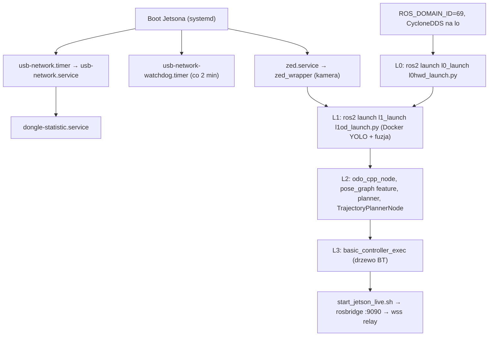

# Uruchamianie i launch

> [!skrot] W 30 sekund
> - **Nie ma jednego skryptu „start łodzi”.** W `~/solar` nie ma wspólnego workspace’u, pliku `.repos` ani skryptu, który odpala cały stos. Każda warstwa ma własny launch (L0, L1) albo uruchamia się węzłami `ros2 run` (L2, L3). Kolejność startu opisuje tylko pomocniczy dokument `docs/architektura.html` §11 — poniżej sprawdzona z kodem i poprawiona.
> - **Przy boocie Jetsona** startują usługi systemd: modem 5G (`usb-network.timer` → `usb-network.service` → `dongle-statistic.service`), watchdog łącza i kamera ZED (`zed.service`). Sam stos autonomii (L0–L3) nie ma żadnej usługi systemd.
> - **DDS:** `ROS_DOMAIN_ID=69`, `RMW_IMPLEMENTATION=rmw_cyclonedds_cpp`, a CycloneDDS jest zamknięty na interfejs `lo` (`cyclonedds_lo.xml`), czyli cały ruch ROS zostaje na jednym Jetsonie. Z brzegu dane idą przez rosbridge i [[agh-dashboard-live]], nie przez DDS.
> - **Gdzie to działa:** Jetson Orin (użytkownik `solar`, host `jetson`) — `dongle-service/README.md`, `dongle-statistic.service` (`User=solar`, `/home/solar/...`).

Powiązane: [[Środowisko developerskie (Docker ROS2)]] · [[Git — praca z repozytoriami koła]] · [[Dokumenty i raporty]] · repozytoria [[l0hwd]], [[l1od]], [[l2dp]], [[l3nav]], [[l4sim]], [[ros-sbt-interfaces]], [[dongle-service]], [[zed-ws]], [[agh-dashboard-live]].

## Workspace i budowanie

### `~/solar/bash_do_uruchomienia/`
To zestaw ośmiu klonów repo, każdy z własnym `.git` (stan z 30.07.2026, daty katalogów). **Nie zawiera** żadnego skryptu startowego, `src/`, `build/`, `install/` ani pliku `.repos`/`colcon.meta`, mimo nazwy katalogu. Służy jako zestaw repozytoriów „na gałęziach głównych”:

| Katalog | Remote (`git remote -v`) | Wymeldowana gałąź | HEAD | Zmiany |
|---|---|---|---|---|
| `dongle-service` | `agh-solar-boat/ab/dongle-service` | `main` | `cbfd591` 2025-09-25 „Merge branch 'New_IP_for_Jetson' into 'main'” | 0 |
| `fusion_camera_lidar` | `agh-solar-boat/ab/fusion_camera_lidar` | `main` | `9c91863` 2025-01-25 | 0 |
| `l1od` | `agh-solar-boat/ab/l1od` | `master` | `55ded22` 2026-04-27 „Refine running models on CPU.” | 0 |
| `l2dp` | `agh-solar-boat/ab/l2dp` | `master` | `74c473e` 2026-04-29 „fast_scan config” | 0 |
| `l3nav` | `agh-solar-boat/ab/l3nav` | `master` | `dd07b54` 2026-07-19 „merge monaco-cleanup and apply final fixes” | 0 |
| `l4sim` | `agh-solar-boat/ab/l4sim` | `main` | `7a789a2` 2026-05-25 „monaco figure 8” | 0 |
| `ros-sbt-interfaces` | `agh-solar-boat/ab/ros-sbt-interfaces` | `main` | `c7322b5` 2026-07-21 „can changes” | 0 |
| `zed-ws` | `agh-solar-boat/ab/zed-ws` | `main` | `d72d973` 2024-11-27 „readme” | 0 |

Brakuje tu [[l0hwd]] (jest tylko w `~/solar/l0hwd`). Ostatni fetch (`.git/FETCH_HEAD`) jest tylko w `ros-sbt-interfaces` (2026-09-07); pozostałe kopie nie mają `FETCH_HEAD`.

### Główne kopie w `~/solar/*` = stan z Jetsona po zawodach
Repozytoria w katalogu głównym `~/solar` (`l0hwd`, `l1od`, `l2dp`, `l3nav`, `ros-sbt-interfaces`, `dongle-service`, `zed-ws`) mają te same HEAD-y co `~/ros2-humble-gpu/ws/src/*` (np. `l2dp` `cb93270` na `spirala_zjebania`, `l3nav` `e336cd3` na `waypoint_first`). Zapis sesji w `~/solar/2026-09-16-…txt` (linie 5217–5240) mówi, że to kopia skopiowana z Jetsona („stan z łodzi”). Szczegóły gałęzi — w notatkach repo.

> [!wazne] Kopia straciła bity wykonywalności
> `git diff` w `~/solar/l1od` i `~/solar/l0hwd` pokazuje tylko `old mode 100755 → new mode 100644` dla `vision_detector/docker/run.sh`, `build.sh`, `entrypoint.sh` i `l0_launch/launch/l0hwd_launch.py`. Na tej kopii `l1od_launch.py` nie uruchomi `run.sh` (brak `+x`), dopóki nie zrobisz `chmod +x`. Na Jetsonie (źródło) te pliki są wykonywalne (tryb `100755` w gicie).

### Jak się buduje (z plików)
- **Brak wspólnego skryptu budowania.** Jedyne komendy `colcon` w repozytoriach:
  - `dongle-service/README.md`: `colcon build` + `source install/setup.bash` w katalogu `dongle-service`.
  - `l1od/vision_detector/docker/Dockerfile_jetson:90`: `colcon build --packages-select vision_detector l1_interfaces --symlink-install` (w obrazie). `entrypoint.sh:10` przy `CB=1`: `colcon build --packages-select l1_interfaces vision_detector` (bez symlinków).
  - `l1od/.gitlab-ci.yml`: CI klonuje [[ros-sbt-interfaces]] obok i robi `colcon build` — czyli **interfejsy muszą być w tym samym workspace** co warstwa.
  - `~/ros2-humble-gpu/ros2dev` `build-ws`: `colcon build --symlink-install --cmake-args -DCMAKE_BUILD_TYPE=RelWithDebInfo -DCMAKE_EXPORT_COMPILE_COMMANDS=ON` (PC, patrz [[Środowisko developerskie (Docker ROS2)]]).
- **Konwencja ścieżki workspace’u:** `l1od/README.md:48` i skrypty Dockera używają `$DEV_WS_DIR/src/l1od/...` (np. `DEV_WS_DIR=/home/{user}/dev_ws`). Sesja z 2026-08/09 i `docs/architektura.html` mówią o `~/ros2_ws/src` na laptopie Patryka. Skrypt ZED szuka `~/zed_ws/install/setup.bash` (`zed-pls-dont-die.sh:27`).
- **Kolejność (wynika z zależności, nie ze skryptu):** najpierw [[ros-sbt-interfaces]] (`l0_interfaces`…`l4_interfaces`), potem warstwy. `colcon` sam ustala kolejność z `package.xml`, o ile wszystko jest w jednym `src/`.
- **Duplikaty pakietów:** `~/solar/l2dp/COLCON_IGNORE` (pusty, nieśledzony — `git status: ?? COLCON_IGNORE`) wyłącza całe `l2dp`, żeby colcon nie widział dwóch kopii tych samych pakietów co w `l2dp_docking_fix`. `zed-ros2-wrapper-humble-v5.1.0/COLCON_IGNORE` wyłącza rozpakowany wrapper ZED. W PC‑owym `~/ros2-humble-gpu/ws/build` zbudowane są `pose_graph`, `segment_scan`, `pointcloud_to_laserscan` właśnie z `l2dp_docking_fix` (`CMAKE_HOME_DIRECTORY` w `CMakeCache.txt`).
- **Zależności spoza `~/solar`:** `l0hwd_launch.py:23` dołącza `hesai_ros_driver/launch/start.py` (sterownik LiDAR-u Hesai), a dashboard subskrybuje `xsens_mti_ros2_driver/msg/XsStatusWord` (`start_jetson_live.sh`). Żadnego z tych pakietów nie ma w `~/solar` — muszą być w workspace na Jetsonie. **Niepewne:** jak i skąd są uruchamiane (żaden launch w `~/solar` nie startuje sterownika Xsens).

## Pliki launch — mapa

Stan: wymeldowane gałęzie kopii w `~/solar` (+ `bash_do_uruchomienia/l4sim`). Pełna lista węzłów z remapami jest w `run.json` (pole `launch`).

| Plik launch | Pakiet / repo | Co startuje | Argumenty (domyślne) |
|---|---|---|---|
| `l0hwd/l0_launch/launch/l0hwd_launch.py` | `l0_launch` / [[l0hwd]] | include `ros2_socketcan/launch/socket_can_bridge.launch.xml`; include `hesai_ros_driver/launch/start.py`; `can_driver/CanDriver`; `new_diff_thrust_driver/NewDiffThrustDriver`; `peripherals_handler/PeripheralsHandler` | brak |
| `l0hwd/ros2_socketcan/ros2_socketcan/launch/socket_can_bridge.launch.xml` | `ros2_socketcan` (submoduł upstream Autoware, `8996cdb` 1.2.0) / [[l0hwd]] | include receiver + sender `.launch.py` → LifecycleNode `socket_can_receiver` (pub `from_can_bus`), `socket_can_sender` (sub `to_can_bus`) | `interface:=can0`, `receiver_interval_sec:=0.01`, `sender_timeout_sec:=0.01`, `enable_can_fd:=false` |
| `…/socket_can_receiver.launch.py` / `…/socket_can_sender.launch.py` | `ros2_socketcan` | po jednym LifecycleNode (auto configure/activate) | receiver: `interface`, `interval_sec`, `use_bus_time:=false`, `filters:=0:0`, `auto_configure/auto_activate:=true`; sender: `interface`, `timeout_sec`, `enable_can_fd` |
| `l0hwd/sonar/launch/sonar.launch.py` | `sonar` / [[l0hwd]] | `sonar/depth_logger` (nazwa `depth_logger`) | brak; parametry wpisane: `gnss_topic=/gnss`, `depth_topic=/echologger/depth`, `depth_msg_type=range`, `raw_echo_topic=/echologger/raw_echo`, `sample_hz=5.0`, `csv_dir=/tmp/boat_echo_logs`, `rotate_max_mb=100.0`, `rotate_keep=10` |
| `l1od/l1_launch/launch/l1od_launch.py` (gałąź `refined-fusion`) | `l1_launch` / [[l1od]] | `ExecuteProcess`: `$DEV_WS_DIR/src/l1od/vision_detector/docker/run.sh <vision_detector> CB=… CT=…` (detektor w Dockerze); `detection_pointcloud_fusion/DetectionPointCloudFusion` z `real_or_sim=real` | `camera_fov:=1.76278254` (zadeklarowany, nieużywany), `confidence_threshold:=0.7`, `vision_detector:=buoy_detector`, `vision_detector_CB:=0` |
| ten sam plik na `master` (`bash_do_uruchomienia/l1od`) | `l1_launch` | `run.sh` + `obstacle_detector/ObstacleDetector` + `detection_fusion/DetectionFusion` (`yolo_topic=/l1/detection_<vision_detector>`) + `tracking_detection/TrackingDetection` | jak wyżej + `x/y/z_axis_min/max`, `tolerance:=0.2`, `cluster_*`, `ground_tolerance:=0.3`, `fusion_angle_threshold:=0.07`, `fusion_distance_threshold:=1.0`, `real_or_sim:=real`, `tracking_tolerance:=1.5` |
| `l1od/l1_launch/launch/sim_launch.py` | `l1_launch` / [[l1od]] | `run.sh buoy_detector_simulation` z `CTR=/zed/zed_node/rgb/color/rect/image:=/wamv/sensors/cameras/front_left_camera_sensor/image_raw`, `DTR=/zed/zed_node/point_cloud/cloud_registered:=/wamv/.../points`; `DetectionPointCloudFusion` (`real_or_sim=sim`, kamera 960×720, `lidar_topic=/wamv/sensors/lidars/lidar_wamv_sensor/points`, `yolo_topic=/l1/detection_buoy_detector_simulation`) | `camera_fov`, `confidence_threshold:=0.7`, `vision_detector_CB:=0` |
| `l1od/l1_launch/launch/l1od.yaml` | `l1_launch` | bez Dockera: `vision_detector/buoy_detector`, `ObstacleDetector`, `DetectionFusion`, `TrackingDetection`, `gps_calculator/GpsConverter` | brak |
| `l1od/l1_launch/launch/sim.yaml` | `l1_launch` | to samo w wersji symulacyjnej z remapami na topiki `/wamv/sensors/...` | brak |
| `l1od/obstacle_detector/launch/obstacle_detector.launch.py` | `obstacle_detector` / [[l1od]] | `ObstacleDetector` z plikiem yaml | `config_file:=<share>/obstacle_detector/config/sim_config.yaml` |
| `l2dp/pointcloud_to_laserscan/launch/sample_pointcloud_to_laserscan_launch.py` | `pointcloud_to_laserscan` / [[l2dp]] | `pointcloud_to_laserscan_node`, remap `cloud_in→/lidar_points`, `scan→/scan` | `scanner` (nieużywany); parametry: `target_frame=hesai_lidar`, `min_height=-0.6`, `max_height=0.1`, `angle_min/max=±3.1415` (na `master`: ±3.15), `range_min=0.6`, `range_max=30.0` |
| `l2dp/pointcloud_to_laserscan/launch/sample_laserscan_to_pointcloud_launch.py` | `pointcloud_to_laserscan` | demo upstream: `ros2 topic pub` sztucznego skanu + `static_transform_publisher map→scan` + `laserscan_to_pointcloud_node` | `scanner:=scanner` |
| `l2dp/segment_scan/launch/segment_scan.launch.py` (też `l2dp_docking_fix`; brak na `master`) | `segment_scan` / [[l2dp]] | `segment_scan/segment_scan` jako `segment_scan_node` | `params_file:=<share>/segment_scan/config/segment_scan_params.yaml` |
| `sbt_transforms/launch/sbt_transforms.launch.py` | [[sbt_transforms]] (bez gita) | `sbt_tf_bridge`, `sbt_axis_normalizer` (warunkowo), `sbt_axis_audit` (warunkowo) | `params_file:=<share>/sbt_transforms/config/sbt_transforms.yaml`, `enable_audit:=true`, `enable_normalizer:=true` |
| `dongle-service/dongle_statistic/launch/dongle_statistic_launch.py` | `dongle_statistic` / [[dongle-service]] (gałąź `Dongle-Statistic`) | `dongle_statistic_node` | `interface:=wlan0`, `publish_rate:=0.2` |
| `zed-ros2-wrapper-humble-v5.1.0/zed_wrapper/launch/zed_camera.launch.py` | `zed_wrapper` (upstream Stereolabs v5.1.0) / [[zed-ws]] | kontener komponentów z `stereolabs::ZedCamera` (nazwa `zed_node`, namespace = `camera_name` = `zed`) + `robot_state_publisher` | `camera_model` (wymagany; skrypt watchdoga daje `zedx`), `camera_name:=zed`, `node_name:=zed_node`, `publish_tf:=true`, `publish_map_tf:=true`, `svo_path:=live` i in. |
| `l4sim/src/l4_launch/launch/sim.yaml` | `l4_launch` / [[l4sim]] | `sim_can_adapter/SimCanAdapter`, `course_imu/CourseImu` | brak |
| `l4sim/src/vrx/vrx_gz/launch/competition.launch.py` | `vrx_gz` / [[l4sim]] | Gazebo + spawn WAM-V + mosty ROS↔GZ (`vrx_gz.launch.simulation/spawn/competition_bridges`) | `world:=sydney_regatta`, `sim_mode:=full`, `bridge_competition_topics:=True`, `config_file`, `robot`, `headless:=False`, `urdf`, `paused:=False`, `competition_mode:=False`, `extra_gz_args`, `name:=wamv` |
| `vrx_gz/launch/vrx_environment.launch.py`, `spawn.launch.py`, `spawn_config.launch.py`, `usv_joy_teleop.py` | `vrx_gz` / [[l4sim]] | warianty VRX (środowisko, sam spawn, teleop `joy_node` + `joy_teleop`) | jak w VRX |
| `vrx_urdf/vrx_gazebo/launch/generate_wamv.launch.py`, `rviz.launch.py`; `vrx_ros/launch/monitor_sim.py` | VRX / [[l4sim]] | generowanie URDF WAM-V, RViz2, monitor symulacji | — |

> [!blad] Nieaktualne komendy w README
> - `l0hwd/README.md:51`: `ros2 launch l0_launch l0hwd.py` — plik nazywa się `l0hwd_launch.py`.
> - `l0hwd/README.md:46`: `ros2 launch ros2_socket_can socket_can_bridge.xml` — pakiet to `ros2_socketcan`, plik `socket_can_bridge.launch.xml`.
> - `docs/architektura.html` §11: `ros2 run odometry OdoCpp` — executable to `odo_cpp_node` (`l2dp/odometry/CMakeLists.txt`); `pose_graph <exec>` to `feature` (`l2dp/pose_graph/CMakeLists.txt`; `src/main.cpp` uruchamia w jednym procesie `FeatureExtractor` + `GlobalMapBuilder`); `trajectory_planner <exec>` to `TrajectoryPlannerNode`.

## Pełny start łodzi (rekonstrukcja)

**Niepewne:** w repozytoriach nie ma skryptu, który to robi. Kolejność pochodzi z `docs/architektura.html` §11 (dokument pomocniczy), nazwy executabli są poprawione według `CMakeLists.txt`. Każdy terminal: `source /opt/ros/humble/setup.bash && source <ws>/install/setup.bash` i zmienne z sekcji DDS.

0. **Boot Jetsona (automatycznie):** `usb-network.timer` (1 min po boocie) → `usb-network.service` (DHCP na `usbX`, trasa domyślna) → `dongle-statistic.service`; `usb-network-watchdog.timer` co 2 min; `zed.service` (kamera ZED). Szczegóły niżej.
1. **Zmienne środowiska** (`l1od/README.md:46-50`): `ROS_DOMAIN_ID=69`, `ROS_LOCALHOST_ONLY=0`, `RMW_IMPLEMENTATION=rmw_cyclonedds_cpp`, `DEV_WS_DIR=<workspace>`, `VISION_DETECTOR_DOCKER_DEVICE=JETSON`. Interfejs `can0` musi być podniesiony — **w repo nie ma skryptu, który go konfiguruje** (jedyne skrypty `ip link` tworzą wirtualne `vcan0`/`zcan0` do testów).
2. **L0 — sprzęt:** `ros2 launch l0_launch l0hwd_launch.py` (most CAN `can0`, LiDAR Hesai, `CanDriver`, `NewDiffThrustDriver`, `PeripheralsHandler`). Opcjonalnie `ros2 launch sonar sonar.launch.py`. Sterownik Xsens (IMU/GNSS: `/imu/data`, `/gnss`, `/filter/*`) — **niepewne**, poza `~/solar`.
3. **Kamera:** już działa z `zed.service` (topik `/zed/zed_node/rgb/color/rect/image`); ręcznie: `ros2 launch zed_wrapper zed_camera.launch.py camera_model:=zedx`.
4. **L1 — percepcja:** jednorazowo `src/l1od/vision_detector/docker/build.sh` (obraz `vision_detector_image`), potem `ros2 launch l1_launch l1od_launch.py vision_detector:=buoy_detector confidence_threshold:=0.7`.
5. **L2 — lokalizacja, SLAM, planowanie** (po jednym węźle, bez launcha): `ros2 run odometry odo_cpp_node`, `ros2 run pose_graph feature --ros-args --params-file <l2dp>/pose_graph/config/slam.yaml`, `ros2 run planner planner`, `ros2 run trajectory_planner TrajectoryPlannerNode`; do dokowania `ros2 launch segment_scan segment_scan.launch.py` + `pointcloud_to_laserscan` (wzór z `~/ros2-humble-gpu/ws/tools/run_dock_test.sh`).
6. **L3 — decyzja:** `ros2 run basic_controller basic_controller_exec --ros-args -p main_tree_name:=<Drzewo>` (`l3nav/README.md:68-78`), podgląd: `ros2 run basic_controller bt_tui_viewer`.
7. **Brzeg / telemetria:** `agh-dashboard-live/scripts/start_jetson_live.sh` (rosbridge na porcie 9090 + RTSP + przekaźnik WebSocket) — patrz [[agh-dashboard-live]].

L4 nie jest warstwą runtime łodzi: [[ros-sbt-interfaces]] to tylko definicje wiadomości, a [[l4sim]] to symulacja na PC.

### Symulacja (PC, [[l4sim]])
`l4sim/README.md:62-86` (ręcznie): `ros2 launch vrx_gz competition.launch.py world:=RB_FOLLOW_THE_PATH`, `ros2 launch vrx_gazebo rviz.launch.py use_sim_time:=true`, potem `imu_rotator ImuRotator`, `odometry odo_cpp_node`, `pointcloud_to_laserscan sample_pointcloud_to_laserscan_launch.py`, `scan_rotator ScanRotator`, `mapper mapper`, `planner planner`, `imu_to_yaw imu_to_yaw`, `sim_can_adapter SimCanAdapter`, `regulator Regulator --ros-args -p sim:=true`, `TrajectoryPlanner TrajectoryPlannerNode`, `sim_thrust_driver SimThrustDriver`, `basic_controller basic_controller_exec`. W Dockerze: `docker-compose.yml` (kontener `vrx-garden`, `ROS_DOMAIN_ID=42`, `network_mode: host`, `privileged`) uruchamia `/scripts/start-simulation-test.sh` → `ros2 launch vrx_gz competition.launch.py world:=$VRX_DEFAULT_WORLD` (domyślnie `sydney_regatta`) w tle, po 10 s `ros2 launch l4_launch sim.yaml`. CLI `bin/solar3000` (`DEFAULT_WORLD=NJORD_NAV`): `start [world]`, `setup`, `build`, `stop`, `clean`, `diagnose`, `status`, `worlds`, `logs`, `shell`, `gui-fix`. Światy: `vrx_gz/worlds/` (m.in. `NJORD_NAV.sdf`, `NJORD_DOCKING1/2.sdf`, `MONACO26_FIGURE8.sdf`, `RB26_*.sdf`).

## Skrypty `.sh` w `~/solar`

Pominięto `build/install/log/node_modules` i upstreamowe skrypty CI/Dockera wrappera ZED (`zed-ros2-wrapper-humble-v5.1.0/.ci/*.sh`, `docker/*.sh`) oraz VRX (`vrx_gz/hooks/resource_paths.sh`, `update_sea_state_params.sh`).

### Jetson — usługi i łącze
| Skrypt | Co robi | Argumenty / zmienne | Gdzie |
|---|---|---|---|
| `zed-service/zed-pls-dont-die.sh` | Watchdog kamery: `setsid ros2 launch $LAUNCH_PKG $LAUNCH_FILE $LAUNCH_ARGS`, po rozgrzewce co `SILENCE_TIMEOUT` s sprawdza `ros2 topic echo --once $TOPIC`; gdy proces padnie albo topik milczy — SIGINT do grupy procesów, po 20 s SIGKILL, przerwa `RESTART_DELAY`, start od nowa. Odmawia pracy pod `sudo` (bo `HOME=/root` i znika `ROS_DOMAIN_ID`) i gdy `RMW_IMPLEMENTATION` ma śmieci. | `ROS_DOMAIN_ID` (domyślnie `69`), `ROS_SETUP=/opt/ros/humble/setup.bash`, `WS_SETUP` (`<katalog skryptu>/install/setup.bash` albo `~/zed_ws/install/setup.bash`), `LAUNCH_PKG=zed_wrapper`, `LAUNCH_FILE=zed_camera.launch.py`, `LAUNCH_ARGS=camera_model:=zedx`, `TOPIC=/zed/zed_node/rgb/color/rect/image`, `SILENCE_TIMEOUT=5`, `RESTART_DELAY=10`, `WARMUP=15` | Jetson |
| `zed-service/zed-healthcheck.sh`, `zed-service/zed-run.sh` | **Puste pliki (0 bajtów).** | — | — |
| `dongle-service/usb-network.sh` | Szuka interfejsów `usb*` w `/sys/class/net`, wypisuje vendor/model/port (udevadm), `ip link set up`, DHCP przez `dhclient` i `udhcpc` (po 10 s timeoutu), przy sukcesie `route add -net 0.0.0.0 <iface>` i kończy. | brak; wymaga sudo | Jetson, instalowany do `/usr/local/bin/` |
| `dongle-service/usb-network-watchdog.sh` | (nieśledzony, z gałęzi `QoL/fixes_hotplug_watchdog_doctor`) Jeśli jest `usb*`, a ping do `1.1.1.1`/`8.8.8.8` nie przechodzi → `systemctl restart usb-network.service`. | root | Jetson |
| `dongle-service/dongle-doctor.sh` | (nieśledzony) Jednorazowa diagnoza: port AT `/dev/ttyUSB2` (SIM `AT+CPIN?`, sygnał `AT+CSQ`, operator `AT+COPS?`), interfejs `usbX`, IP, trasa domyślna, ping, Tailscale. | sudo dla AT | Jetson |
| `dongle-service/dongle-cli.sh` | (nieśledzony, ~31 kB) Narzędzie „Njord 2026”: `wizard`, `detect`, `configure [APN]`, `net`, `install` (kopiuje skrypty do `/usr/local/bin`, unity do `/etc/systemd/system`, regułę udev, `systemctl enable --now usb-network.timer usb-network-watchdog.timer`), `tailscale`, `doctor`, `monitor`, `logs`, `help`; bez argumentów — menu. | subkomenda | Jetson |
| `dongle-service/dongle_setup.sh` | Czeka na podłączenie modemu (`/dev/ttyUSB2`) i odpala `minicom -D /dev/ttyUSB2 -S minicom_script` (konfiguracja AT). README: „tylko w skrajnych sytuacjach”. | brak | Jetson |
| `agh-dashboard-live/scripts/start_jetson_live.sh` | Start podglądu na brzeg — opis w [[agh-dashboard-live]]. | `BOAT_ID=barka|celka`, `BOAT_WORKSPACE_SETUP`, dziesiątki `TOPIC_*`/`TYPE_*` | Jetson (nazwa skryptu) |

### Percepcja (Docker) — [[l1od]]
| Skrypt | Co robi | Argumenty / zmienne | Gdzie |
|---|---|---|---|
| `l1od/vision_detector/docker/build.sh` | `docker build` obrazu `vision_detector_image` z `Dockerfile_cpu|_gpu|_jetson` (kontekst = `$DEV_WS_DIR`; Jetson z `--network=host`). | `VISION_DETECTOR_DOCKER_DEVICE=CPU|GPU|JETSON`, `DEV_WS_DIR` | Jetson lub PC |
| `l1od/vision_detector/docker/run.sh` | Zatrzymuje stare kontenery z tego obrazu, `docker run --network host --rm` z montowaniem `$DEV_WS_DIR/src → /ros2_ws/src`; GPU: `--gpus all --runtime=nvidia --ipc host --pid host`; Jetson: `--runtime=nvidia`, `LD_LIBRARY_PATH=/usr/local/cuda/lib64:...`. | `./run.sh <node_name> [CB=1] [CT=0.7] [CTR=from:=to] [DTR=from:=to]` | Jetson lub PC |
| `l1od/vision_detector/docker/entrypoint.sh` | W kontenerze: `source /opt/ros/$ROS_DISTRO`, opcjonalnie `colcon build` (`CB=1`), `source env_setup.sh`, `exec ros2 run vision_detector <node> --ros-args -p confidence_threshold:=… [--remap …]`. | `CB`, `CT`, `CTR`, `DTR` (ENV) | kontener |
| `l1od/env_setup.sh` | Do `source`: `L1_REPO_ROOT`, `git submodule update --init`, alias `l1_format` (clang-format), ścieżki modeli `BUOY_MODEL_PATH` (`njord26/navier30k.pt`), `BUOY_ROBOBOAT_MODEL_PATH`, `BUOY_BAGRY_MODEL_PATH`, `BASE_DETECTOR_MODEL_PATH` (`yolo11n.engine`), `CELKA_*`, `CAMERA_FOV` (już nieużywany). Na `master` inne modele (`RB26/roboboat_lights_plackards.engine`, `yolo11s.engine`). | — | wszędzie |
| `bash_do_uruchomienia/fusion_camera_lidar/docker/build.sh`, `run.sh` | Obraz `ros2_camera_lidar_fusion`; `run.sh` uruchamia go z X11 (`xhost +local:docker`), `--net host --ipc host --pid host --privileged`, montuje repo do `/ros2_ws/src/ros2_camera_lidar_fusion` albo robi `docker exec` do działającego. | brak | PC (GUI) |

### Narzędzia deweloperskie
| Skrypt | Co robi |
|---|---|
| `l0hwd/gitenv.sh`, `l3nav/gitenv.sh` | Do `source`: aliasy `l0_format` / `l3_format` (clang-format z `.clang-format-l0/-l3`). |
| `l0hwd/can-msgs/generate.sh` | Generuje C z `barka.dbc` przez `cantools generate_c_source --use-float` do `src/`, opcjonalnie testowa kompilacja `gcc`. |
| `l0hwd/ros2_socketcan/ros2_socketcan/test/vcan0_setup.sh` / `vcan0_teardown.sh` | Tworzy/usuwa wirtualne `vcan0` (testy upstream). |
| `embedded-system/communication/check_diff.sh` | Sprawdza, czy kod wygenerowany z `communication/delta.dbc` zgadza się z repo. |
| `embedded-system/user_input_board/scripts/setup_native_sim_can.sh` | Tworzy wirtualne `zcan0` (symulacja natywna Zephyr). |
| `bash_do_uruchomienia/l4sim/**` | ~30 skryptów „Solar 3000”: instalatory (`install-wizard.sh`, `install-cli.sh`), start (`scripts/start-simulation*.sh`, `auto-setup-and-run.sh`, `build-and-run.sh`), diagnostyka WSL2/GPU/GUI (`check-wsl2.sh`, `diagnose-gui.sh`, `diagnose-gazebo-black-screen.sh`, `tools/test-gpu.sh`, `check-integrated-gpu.sh`), `generate-compose-config.sh` (override docker-compose z GPU i limitami), `entrypoint.sh` (source ROS + `/workspace/install`, test OpenCV). Szczegóły: [[l4sim]]. |

## Usługi systemd (co startuje przy boocie)

| Unit | Plik w repo | Start | Co uruchamia |
|---|---|---|---|
| `usb-network.timer` | `dongle-service/usb-network.timer` | `OnBootSec=1min`, `WantedBy=timers.target` | `usb-network.service` |
| `usb-network.service` | `dongle-service/usb-network.service` | `Type=oneshot`, po `network-online.target` | `/usr/local/bin/usb-network.sh`, potem `ExecStartPost=/bin/systemctl start dongle-statistic.service` |
| `99-usb-network-hotplug.rules` (udev) | `dongle-service/` (nieśledzony) | podłączenie interfejsu `usb*` | `SYSTEMD_WANTS=usb-network.service` |
| `usb-network-watchdog.timer` / `.service` | `dongle-service/` (nieśledzone) | `OnBootSec=3min`, `OnUnitActiveSec=2min` | `/usr/local/bin/usb-network-watchdog.sh` |
| `dongle-statistic.service` | `dongle-service/dongle-statistic.service` | `WantedBy=multi-user.target`, `Restart=on-failure` | `ros2 launch dongle_statistic dongle_statistic_launch.py` jako `User=solar`, `WorkingDirectory=/home/solar/dongle-service` |
| `zed.service` | `zed-service/zed.service` | `WantedBy=multi-user.target`, `Restart=always`, `RestartSec=15`, `After=docker.service network-online.service`, `Requires=docker.service` | `ExecStart=/usr/local/bin/zed-healthcheck.sh`, `EnvironmentFile=/etc/default/zed` |

> [!blad] Niespójności w `zed-service`
> - `zed.service` uruchamia `/usr/local/bin/zed-healthcheck.sh`, a w repo `zed-healthcheck.sh` jest **pusty**; watchdog z logiką to `zed-pls-dont-die.sh`. **Niepewne:** co faktycznie leży w `/usr/local/bin/` na Jetsonie.
> - Ostatnia linia pliku (`BindsTo=zed.service — zatrzymanie kamery zatrzymuje watchdoga automatycznie.`) jest luźnym tekstem w sekcji `[Install]` — wygląda na wklejony komentarz z innej jednostki (systemd zgłosi ostrzeżenie).
> - `Requires=docker.service`, choć skrypt uruchamia `ros2 launch` natywnie, nie w Dockerze.
> - Domyślny `camera_model:=zedx`, a `l1od/env_setup.sh` i `l1od/README.md` mówią o ZED 2i. **Niepewne**, jaki model jest na łodzi (może nadpisywać `/etc/default/zed`).

> [!wazne] `dongle-statistic.service` — wersja zacommitowana vs robocza
> Na gałęzi `Dongle-Statistic` w gicie jest `ROS_DOMAIN_ID=0`. Kopia robocza (niezacommitowana) zmienia to na `ROS_DOMAIN_ID=69`, `ROS_LOCALHOST_ONLY=0`, `RMW_IMPLEMENTATION=rmw_cyclonedds_cpp`, `CYCLONEDDS_URI=file:///home/solar/cyclonedds_lo.xml`. Instalacja z gita da węzeł niewidoczny dla reszty stosu.

## DDS, sieć i adresy

### Zmienne ROS w plikach
| Źródło | `ROS_DOMAIN_ID` | RMW | inne |
|---|---|---|---|
| `l1od/README.md:46-50`, `docs/architektura.html` | 69 | `rmw_cyclonedds_cpp` | `ROS_LOCALHOST_ONLY=0` |
| `l1od/vision_detector/docker/Dockerfile_jetson:6-13` | 69 | `rmw_cyclonedds_cpp` | `CYCLONEDDS_URI=file:///etc/cyclonedds/cyclonedds_lo.xml` |
| `l1od/vision_detector/docker/Dockerfile_cpu:7-9` | 69 | `rmw_cyclonedds_cpp` | — |
| `l1od/vision_detector/docker/Dockerfile_gpu:5-7` | **68** | `rmw_cyclonedds_cpp` | — |
| `dongle-service/dongle-statistic.service` (roboczy) | 69 | `rmw_cyclonedds_cpp` | `CYCLONEDDS_URI=file:///home/solar/cyclonedds_lo.xml` |
| `zed-service/zed-pls-dont-die.sh:13` | 69 (domyślnie) | z otoczenia | — |
| `l4sim/docker-compose.yml` | **42** | `rmw_cyclonedds_cpp` | `network_mode: host` |
| `~/ros2-humble-gpu/docker-compose.yml` | **0** (domyślnie, `.env`) | domyślny (Cyclone zakomentowany) | `network_mode: host` |

> [!blad] Rozjazd domen
> Obraz `Dockerfile_gpu` (PC z CUDA) ma `ROS_DOMAIN_ID=68`, a reszta 69 — detektor na PC nie zobaczy węzłów na 69, chyba że nadpiszesz zmienną. Symulacja w Dockerze żyje na 42, środowisko PC na 0.

### CycloneDDS
Jedyny plik konfiguracyjny DDS w `~/solar`: `l1od/vision_detector/docker/cyclonedds_lo.xml` (zacommitowany na `refined-fusion`, commit `367d631`). Ustawia:
- `NetworkInterface name="lo"` — **tylko pętla zwrotna** (komentarz mówi „lo i eth0”, ale `eth0` nie jest wpisany),
- `MaxMessageSize=65500B`, `SocketReceiveBufferSize min=10MB`, `WhcHigh=20MB` („żeby zmieścić kilka klatek 1,56 MB”).

`Dockerfile_jetson` kopiuje go do `/etc/cyclonedds/`, a kontener działa z `--network host`, więc dzieli `lo` z Jetsonem. `dongle-statistic.service` wskazuje `/home/solar/cyclonedds_lo.xml` — **niepewne**, czy to ta sama zawartość. Wniosek z plików: węzły ROS na Jetsonie rozmawiają przez `lo`; laptop w tej samej sieci **nie zobaczy** topików przez DDS, dopóki ten plik obowiązuje. Plików FastDDS/FastRTPS w `~/solar` nie ma.

### Adresy i dostęp
- **Tailscale** (`dongle-service/README.md`): `ssh solar@jetson` (Jetson Orin), awaryjnie `solar@100.97.3.45`; `ssh solar@jetson-nano` (Jetson Nano), awaryjnie `solar@100.77.51.123`. Klucz uwierzytelniający Tailscale: ‹ukryte› (wydaje opiekun repo).
- **Historia IP Jetsona Orin** (gałąź `New_IP_for_Jetson`, commit `f6a61ea` 2025-07-26, zmergowana `cbfd591` 2025-09-25): `100.93.169.86` → `100.97.3.45`. Wcześniej `IP_changed` (`4aa534e`, merge `3791f56` 2025-02-22): `100.104.70.118` → `100.93.169.86`.
- **Modem 5G** RM520N-GL: port AT `/dev/ttyUSB2`, tryb `AT+QCFG="usbnet",1` (ECM → interfejs `usbX`), APN ustawiany `AT+CGDCONT` (`dongle-service/README.md`).
- **Dashboard:** rosbridge `ws://127.0.0.1:9090`, przekaźnik `wss://aghsolarboat.pl/live/publish`, RTSP `rtsp://aghsolarboat.pl:8554/barka` (`start_jetson_live.sh`).
- `l2dp_docking_fix` ma drugi remote `jetson → /home/umarly-poeta/ros2_ws/src/l2dp` (ścieżka lokalna na innym komputerze — laptopie, z którego robiono rebase).

## Znane problemy / TODO
- Brak skryptu „start całej łodzi” i brak usługi systemd dla L0–L3 — start ręczny w kilku terminalach.
- Brak konfiguracji `can0` (bitrate, `ip link set can0 up`) w repozytoriach.
- `zed.service` wskazuje pusty skrypt; luźna linia `BindsTo=…` (wyżej).
- `start_jetson_live.sh` szuka `scripts/battery_status_publisher.py`, a w kopii jest `bms_panel.py` z tą samą klasą — patrz [[agh-dashboard-live]].
- `l1od_launch.py` wywali się z `TypeError` na `os.path.join(None, …)`, jeśli nie ustawisz `DEV_WS_DIR` (`l1od_launch.py:27`; opisane też w `docs/architektura.html` §11).

## Źródła
- `~/solar/l0hwd/l0_launch/launch/l0hwd_launch.py`, `l0hwd/README.md`, `l0hwd/ros2_socketcan/ros2_socketcan/launch/*`
- `~/solar/l1od/l1_launch/launch/{l1od_launch.py,sim_launch.py,l1od.yaml,sim.yaml}`, `l1od/README.md`, `l1od/env_setup.sh`, `l1od/vision_detector/docker/*`
- `~/solar/l2dp/{pointcloud_to_laserscan,segment_scan}/launch/*`, `l2dp/*/CMakeLists.txt`
- `~/solar/sbt_transforms/launch/sbt_transforms.launch.py`
- `~/solar/dongle-service/*.sh, *.service, *.timer, 99-usb-network-hotplug.rules, README.md`
- `~/solar/zed-service/*`, `~/solar/zed-ros2-wrapper-humble-v5.1.0/zed_wrapper/launch/zed_camera.launch.py`
- `~/solar/bash_do_uruchomienia/l4sim/{README.md,docker-compose.yml,src/start-simulation-*.sh,src/l4_launch/launch/sim.yaml,bin/solar3000}`
- `~/solar/docs/architektura.html` §11 (pomocniczy)

## Moje notatki
> [!ja] Tu piszesz ty — Albert tej sekcji nie rusza.
